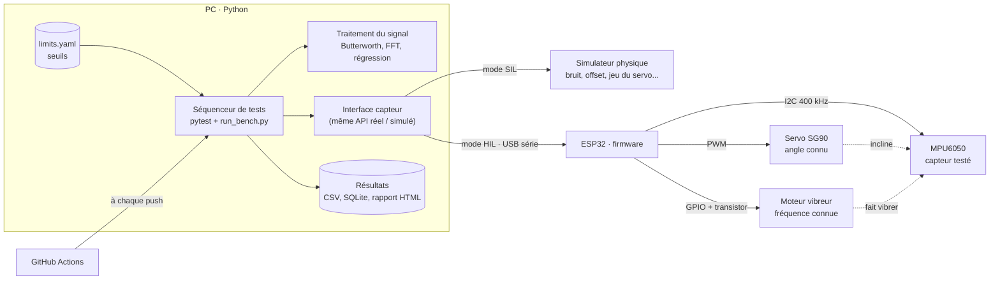
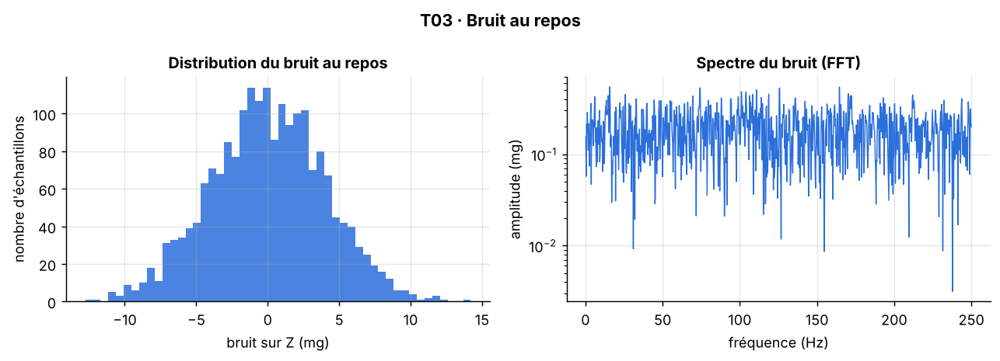
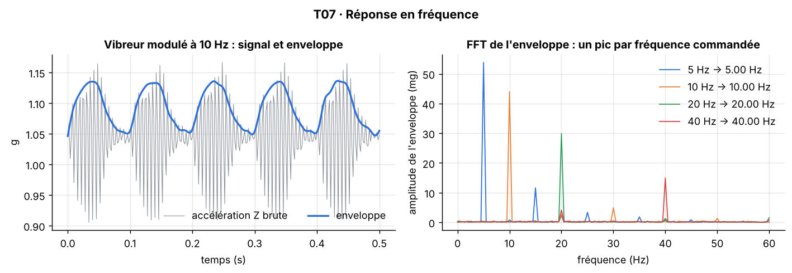
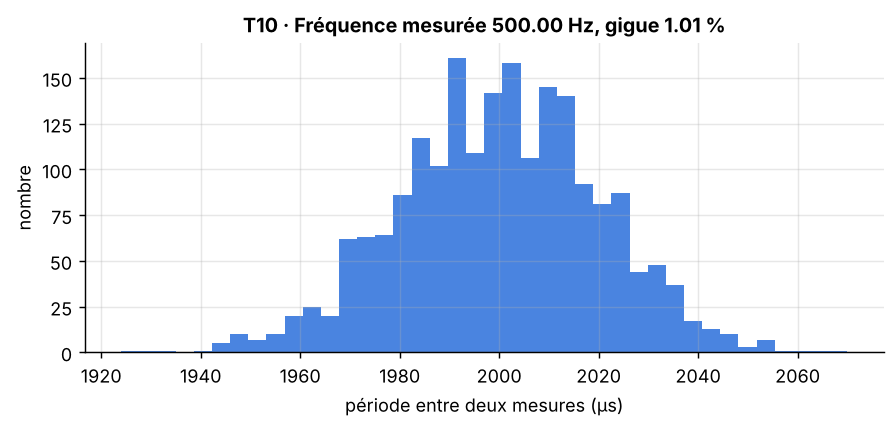
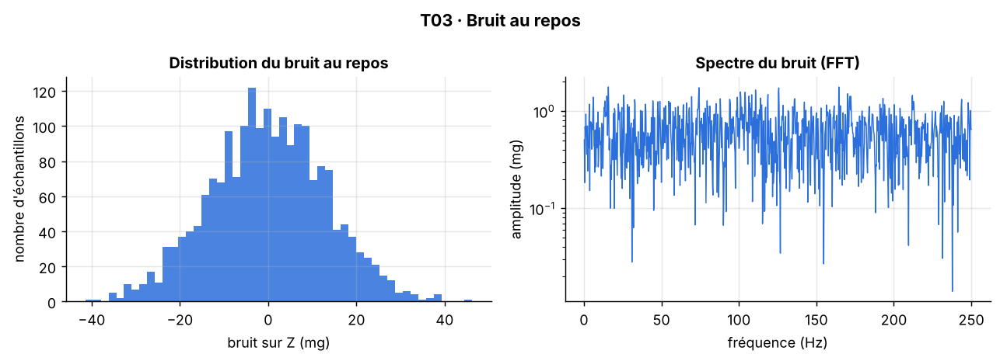
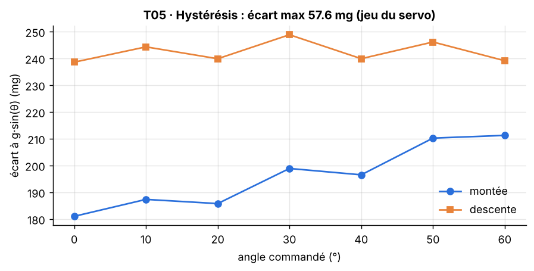

# Banc de test automatisé pour capteur inertiel MPU6050


Banc de test qui **stimule** un capteur (servomoteur pour l'inclinaison, moteur vibreur pour la vibration), **traite son signal** (filtrage, FFT, régression) et rend un **verdict OK/KO automatique** avec rapport, données brutes et traçabilité.

Les mêmes 12 tests tournent sur un **simulateur physique** (SIL, *Software-in-the-Loop*) et sur le **vrai capteur** piloté par un ESP32 (HIL, *Hardware-in-the-Loop*).


*Une seule commande lance la campagne. Le banc accepte le capteur sain et rejette le capteur défectueux en indiquant les tests en échec.*

---

## Sommaire

1. [Démo](#1-démo)
2. [Pourquoi ce projet](#2-pourquoi-ce-projet)
3. [Ce que fait le banc](#3-ce-que-fait-le-banc)
4. [Architecture](#4-architecture)
5. [Matériel et câblage](#5-matériel-et-câblage)
6. [Installation et utilisation](#6-installation-et-utilisation)
7. [Travaux pratiques : les 12 tests et leurs résultats](#7-travaux-pratiques--les-12-tests-et-leurs-résultats)
8. [Le banc rejette un capteur défectueux](#8-le-banc-rejette-un-capteur-défectueux)
9. [Automatisation et intégration continue](#9-automatisation-et-intégration-continue)
10. [Qualité du code et tests](#10-qualité-du-code-et-tests)
11. [Structure du dépôt](#11-structure-du-dépôt)
12. [Limites connues](#12-limites-connues)
13. [Feuille de route](#13-feuille-de-route)
14. [Ce que j'ai appris](#14-ce-que-jai-appris)

---

## 1. Démo

> **[À compléter]** Vidéo de 2 à 3 minutes : le servo s'incline, le vibreur tourne, la courbe s'affiche en direct, puis le verdict OK/KO.
> Sur GitHub, éditer ce fichier et glisser-déposer le fichier `.mp4` ici : GitHub l'héberge et l'affiche directement.

| Montage du banc | Affichage en direct |
|---|---|
| **[À compléter]** photo `docs/media/montage.jpg` | **[À compléter]** GIF `docs/media/live.gif` (enregistré avec `tools/live_plot.py`) |

Exemples de rapports HTML générés automatiquement (à télécharger puis ouvrir dans un navigateur) :

- [Rapport d'un capteur conforme](docs/exemple_rapport_capteur_conforme.html)
- [Rapport d'un capteur défectueux](docs/exemple_rapport_capteur_defectueux.html)

---

## 2. Pourquoi ce projet

Dans l'industrie, chaque capteur passe sur un banc avant d'être livré : on lui applique une grandeur **connue** et on vérifie qu'il mesure ce qu'il doit, dans des tolérances chiffrées. J'ai voulu reproduire cette démarche à petite échelle, de bout en bout :

- **Caractériser** un capteur réel : offset, bruit, linéarité, hystérésis, répétabilité, temps de réponse, réponse en fréquence.
- **Valider une chaîne de traitement du signal** : filtre Butterworth, FFT, détection d'enveloppe, détection de défauts.
- **Automatiser** : exécution, collecte des données, verdict, rapport, traçabilité, intégration continue.

---

## 3. Ce que fait le banc

- **12 tests automatisés** (T01 à T13) avec critères chiffrés dans un fichier de configuration.
- **Deux modes, une seule suite de tests** : simulateur (SIL) ou vrai matériel (HIL), seul le mode change.
- **Stimuli connus** : inclinaison par servomoteur (référence g·sin θ), vibration modulée à fréquence choisie.
- **Traitement du signal** : filtre passe-bas Butterworth à phase nulle, FFT avec fenêtre de Hann, enveloppe, régression linéaire, réponse indicielle, détection de défauts.
- **Rapport HTML autonome** avec un graphique par test, **CSV** des données brutes, **base SQLite** de traçabilité (date, n° de série, version firmware, commit Git, verdicts).
- **Séquence « fin de ligne »** : un grand OK vert ou KO rouge, code de sortie 0/1 exploitable par un script ou une CI.
- **Intégration continue GitHub Actions** : à chaque modification, les tests tournent et le banc doit rejeter un capteur défectueux.
- **Firmware ESP32** avec protocole série simple et acquisition à 500 Hz horodatée.

---

## 4. Architecture



**Choix clé :** les procédures de test ne parlent qu'à une interface abstraite (`bench/base.py`). Le simulateur (`SimulatedSensor`) et le pilote série (`RealSensor`) l'implémentent tous les deux. Cela m'a permis de développer et valider tout le banc avant d'avoir le matériel, puis de passer au réel sans réécrire un seul test.

**Le simulateur n'est pas « parfait » exprès :** il reproduit les défauts qu'un banc doit détecter : offset et erreur de gain par axe (ordres de grandeur de la datasheet), bruit de 4 mg, quantification 16 bits, servo à vitesse limitée (0,1 s pour 60°) avec jeu mécanique de 0,4° et erreur de position, moteur vibreur avec porteuse à 170 Hz et temps de montée, gigue d'horodatage.

---

## 5. Matériel et câblage

| Composant | Rôle | Prix approx. |
|---|---|---|
| ESP32 DevKit | acquisition 500 Hz, pilotage du servo et du vibreur | 6–10 € |
| Module GY-521 (MPU6050) | capteur testé (±2 g, 16384 LSB/g) | 2–4 € |
| Servo SG90 | inclinaison à angle connu | 2–4 € |
| Mini moteur vibreur 3 V | vibration à fréquence connue | 1–2 € |
| Transistor 2N2222, diode 1N4007, résistance 1 kΩ | commande du moteur | 1–2 € |
| Alimentation 5 V séparée pour le servo | évite les chutes de tension sur l'ESP32 | 3–6 € |
| Breadboard, fils, câble USB données | | 5 € |

| Signal | Broche ESP32 | Remarque |
|---|---|---|
| MPU6050 SDA / SCL | GPIO21 / GPIO22 | I2C à 400 kHz, VCC sur 3V3 |
| Servo (signal) | GPIO18 | alimentation 5 V externe, **masses communes** |
| Vibreur | GPIO19 → 1 kΩ → base du 2N2222 | moteur entre 3V3 et collecteur, diode de roue libre en parallèle |

> **[À compléter]** schéma de câblage `docs/media/cablage.png` (Fritzing ou dessin à la main photographié).

Le capteur est fixé sur le bras du servo de façon que l'axe X du MPU6050 s'incline : à l'angle θ, l'accélération attendue est **g·sin θ** sur X et **g·cos θ** sur Z. C'est la référence de tous les tests statiques.

---

## 6. Installation et utilisation

```bash
git clone https://github.com/TON-PSEUDO/sensor-test-bench.git
cd sensor-test-bench
python -m venv .venv && source .venv/bin/activate      # Windows : .venv\Scripts\activate
pip install -r requirements.txt
```

| Commande | Ce qu'elle fait |
|---|---|
| `python run_bench.py` | campagne complète sur le simulateur, rapport dans `reports/` |
| `python run_bench.py --defective` | même campagne sur un capteur simulé hors tolérances |
| `python run_bench.py --mode hil --port COM3` | campagne sur le vrai banc (Linux : `/dev/ttyUSB0`) |
| `pytest` | 44 tests : unitaires, protocole série, système |
| `pytest --mode hil --port COM3` | la suite système sur le vrai matériel |
| `python tools/live_plot.py` | affichage en direct pour filmer la démo |

**Firmware :** ouvrir `firmware/sensor_bench/sensor_bench.ino` dans l'IDE Arduino, installer le support ESP32 et la bibliothèque **ESP32Servo**, téléverser. Le moniteur série (921600 bauds) accepte directement les commandes du protocole :

| Commande | Réponse |
|---|---|
| `ID?` | `ID 0x68` |
| `FS?` / `VER?` | `FS 500` / `VER 1.0.0` |
| `SERVO 30` | `OK` (angle de −80° à 80°, 0° = à plat) |
| `VIB 10` | `OK` (vibreur modulé à 10 Hz, 0 = arrêt) |
| `READ 1000` | `DATA 1000`, 1000 lignes `t_us,ax,ay,az,gx,gy,gz,temp` en valeurs brutes, `END` |
| `STEP 45 1000` | comme `READ`, le servo reçoit l'ordre à l'échantillon 100 |
| commande invalide | `ERR <message>` |

Le firmware stocke d'abord toute l'acquisition en mémoire puis l'envoie : l'écriture sur le port série ne perturbe pas la cadence de 500 Hz.

---

## 7. Travaux pratiques : les 12 tests et leurs résultats

> Résultats ci-dessous : **campagne en simulation (SIL)**, capteur `SIM-0001`. Les seuils sont dans [`config/limits.yaml`](config/limits.yaml). Les résultats sur le vrai capteur sont dans la [section 7.13](#713-résultats-sur-le-vrai-capteur-hil).

| ID | Test | Résultat clé | Critère | Verdict |
|---|---|---|---|---|
| T01 | Communication I2C | WHO_AM_I = 0x68 | = 0x68 | OK |
| T02 | Offset et calibration | offset brut max 45 mg → résidu < 0,2 mg | brut ≤ 150 mg, résidu ≤ 50 mg | OK |
| T03 | Bruit au repos | σ = 4,0 mg, SNR = 47,8 dB | σ ≤ 10 mg, SNR ≥ 40 dB | OK |
| T04 | Linéarité | R² = 0,9999, erreur 0,22 % PE | R² ≥ 0,99, ≤ 2 % PE | OK |
| T05 | Hystérésis | écart max 14,4 mg | ≤ 20 mg | OK |
| T06 | Répétabilité | σ = 0,21 mg sur 10 cycles | ≤ 10 mg | OK |
| T07 | Réponse en fréquence | erreur max 0,002 Hz (5 à 40 Hz) | ≤ 1 Hz | OK |
| T08 | Temps de réponse | établi en 70 ms (montée 58 ms) | ≤ 500 ms | OK |
| T09 | Filtre passe-bas | bruit −75,7 %, niveau décalé de 0,001 % | ≥ 50 %, ≤ 1 % | OK |
| T10 | Échantillonnage réel | 500,0 Hz, gigue 1,0 % | écart ≤ 5 %, gigue ≤ 5 % | OK |
| T12 | Robustesse | 4 erreurs signalées proprement | aucun plantage | OK |
| T13 | Détection de défauts | 5 défauts sur 5, 0 fausse alarme | 100 %, 0 fausse alarme | OK |

### 7.1 TP T01 · Communication I2C

**Objectif :** vérifier que le capteur répond avant tout autre test.
**Méthode :** lecture du registre `WHO_AM_I` (0x75), qui doit valoir 0x68 sur un MPU6050.
**Résultat :** 0x68. Un capteur absent ou mal câblé renvoie une erreur explicite (voir T12).

### 7.2 TP T02 · Offset et calibration

**Objectif :** mesurer le décalage à zéro de chaque axe, puis vérifier que la calibration le corrige.
**Méthode :** capteur à plat (attendu : X = 0 g, Y = 0 g, Z = 1 g), 1 000 mesures, moyenne par axe. Les offsets sont soustraits d'une seconde acquisition indépendante.
**Résultat :** offsets bruts de +34,9 mg (X), −20,3 mg (Y), +45,1 mg (Z), dans l'ordre de grandeur de la datasheet. Après calibration, résidu inférieur à 0,2 mg sur les trois axes.


### 7.3 TP T03 · Bruit au repos

**Objectif :** quantifier le bruit, qui limite la plus petite variation mesurable.
**Méthode :** 2 000 mesures au repos (4 s), écart-type par axe, SNR rapporté à 1 g, spectre FFT.
**Résultat :** σ = 4,0 mg sur les trois axes, SNR = 47,8 dB. Le spectre est plat : bruit blanc, sans fréquence parasite.



### 7.4 TP T04 · Linéarité

**Objectif :** vérifier que la sortie est proportionnelle à la grandeur mesurée et obtenir gain et offset de calibration.
**Méthode :** servo de 0° à 60° par pas de 10°, toujours approché par le même sens, 500 mesures par point. Régression de l'accélération X mesurée sur g·sin θ.
**Résultat :** R² = 0,9999, erreur maximale à la droite de 0,22 % de la pleine échelle (2 g). Gain mesuré 1,023 (2,3 % d'erreur de sensibilité) et offset 27,9 mg : ce sont les coefficients de calibration.


### 7.5 TP T05 · Hystérésis

**Objectif :** vérifier que la mesure ne dépend pas du sens d'arrivée.
**Méthode :** mêmes angles en montée puis en descente, comparaison point par point.
**Résultat :** écart maximal de 14,4 mg, sous la limite de 20 mg. Il vient du **jeu mécanique du servo** (environ 0,4° de chaque côté), pas du capteur : c'est une limite du banc, à connaître pour interpréter les autres mesures.


### 7.6 TP T06 · Répétabilité

**Objectif :** vérifier qu'une même consigne donne la même mesure.
**Méthode :** 10 cycles 0° → 30°, mesure moyenne à 30° à chaque cycle.
**Résultat :** écart-type 0,21 mg, étendue 0,64 mg. Le banc est très répétable car on revient toujours par le même sens.


### 7.7 TP T07 · Réponse en fréquence (FFT)

**Objectif :** vérifier que le capteur et la chaîne d'acquisition restituent une vibration à la bonne fréquence.
**Méthode :** le moteur vibreur tourne vite (porteuse vers 170 Hz). Le banc l'allume et l'éteint à 5, 10, 20 et 40 Hz. On redresse le signal, on le filtre (enveloppe), puis la FFT de l'enveloppe donne la fréquence de modulation. Résolution : 0,25 Hz (2 000 points à 500 Hz), affinée par interpolation parabolique du pic.
**Résultat :** les quatre fréquences sont retrouvées avec une erreur maximale de 0,002 Hz. Les pics secondaires à 3f et 5f sont les harmoniques attendues d'un signal carré.



### 7.8 TP T08 · Temps de réponse

**Objectif :** mesurer la vitesse à laquelle la mesure suit un changement brusque.
**Méthode :** acquisition continue pendant un échelon de 0° à 45°, filtrage à 20 Hz, temps de montée 10–90 % et temps d'établissement à ±5 %.
**Résultat :** montée en 58 ms, établissement en 70 ms, dépassement 0,9 %. Ce temps est dominé par la vitesse du servo (0,1 s pour 60°) : le banc mesure ici la chaîne complète, servo compris.


### 7.9 TP T09 · Validation du filtre passe-bas

**Objectif :** prouver que le filtre retire le bruit sans fausser la mesure.
**Méthode :** Butterworth d'ordre 4, coupure 20 Hz, appliqué en aller-retour (phase nulle, pas de retard). Comparaison du bruit et du niveau moyen avant et après.
**Résultat :** bruit de 3,94 mg à 0,96 mg (−75,7 %), niveau moyen décalé de 0,001 %. C'est cohérent avec la théorie : le bruit blanc s'étale sur 250 Hz et le filtre n'en garde qu'environ 20 Hz, d'où un écart-type divisé par environ √(250/20) ≈ 3,5. On mesure 4,1, car le filtrage aller-retour est un peu plus sélectif qu'un seul passage.


### 7.10 TP T10 · Fréquence d'échantillonnage réelle

**Objectif :** vérifier que la cadence annoncée est la cadence réelle (sinon toutes les FFT sont fausses).
**Méthode :** analyse des horodatages en microsecondes de 2 000 mesures.
**Résultat :** 500,0 Hz mesurés, gigue de 1,0 % sur la période.



### 7.11 TP T12 · Robustesse aux erreurs

**Objectif :** un banc de production ne doit jamais planter : il doit signaler l'erreur et continuer.
**Méthode :** angle hors plage, acquisition de 0 point, commande série inconnue, capteur débranché, puis vérification que le banc répond toujours.
**Résultat :** les 4 erreurs sont levées proprement (`ValueError` côté PC, `SensorError` pour les erreurs du firmware), et le banc reste opérationnel.
**En HIL :** le débranchement du câble I2C se fait à la main pendant la campagne ; le firmware répond `ERR capteur absent sur le bus I2C`.

### 7.12 TP T13 · Détection de défauts injectés

**Objectif :** valider un détecteur de défauts simple et explicable avant d'y ajouter de l'IA.
**Méthode :** 5 défauts typiques sont injectés dans un vrai signal de repos : pic isolé, saturation, capteur figé, dérive lente, bruit fort. Le détecteur utilise une règle par défaut : écart robuste à la médiane (MAD), échantillons à la pleine échelle, longueur des séries de valeurs identiques, pente de régression, bruit estimé par différences successives.
**Résultat :** 5 défauts détectés sur 5, aucune fausse alarme sur le signal sain.


### 7.13 Résultats sur le vrai capteur (HIL)

> **[À compléter après la campagne sur le matériel]** : remplir ce tableau avec `reports/<campagne>/summary.md`, ajouter les graphiques réels (`python run_bench.py --mode hil --port COM3 --docs` les copie dans `docs/images/hil/`) et commenter les écarts avec la simulation.

| ID | Simulation (SIL) | Vrai capteur (HIL) | Commentaire |
|---|---|---|---|
| T02 | offset max 45 mg | | |
| T03 | σ = 4,0 mg | | |
| T04 | R² = 0,9999 | | |
| T05 | 14,4 mg | | |
| T07 | erreur 0,002 Hz | | |
| T08 | 70 ms | | |
| T10 | 500,0 Hz, gigue 1,0 % | | |

---

## 8. Le banc rejette un capteur défectueux

Un banc qui dit toujours OK ne sert à rien. `python run_bench.py --defective` simule un capteur hors tolérances (offset X de 210 mg, bruit de 13 mg, jeu mécanique de 1,6°) :

| Test | Capteur sain | Capteur défectueux | Critère |
|---|---|---|---|
| T02 offset brut X | 34,9 mg · **OK** | 209,6 mg · **KO** | ≤ 150 mg |
| T03 bruit | 4,0 mg, 47,8 dB · **OK** | 13,0 mg, 37,6 dB · **KO** | ≤ 10 mg, ≥ 40 dB |
| T05 hystérésis | 14,4 mg · **OK** | 57,6 mg · **KO** | ≤ 20 mg |

Le banc rend le verdict **KO · CAPTEUR NON CONFORME** et nomme les trois tests en échec. Les autres tests restent OK, ce qui aide au diagnostic : la linéarité (T04) est bonne malgré l'offset, car un offset constant ne déforme pas la droite.

| Bruit du capteur défectueux (T03) | Hystérésis du capteur défectueux (T05) |
|---|---|
|  |  |

---

## 9. Automatisation et intégration continue

| Niveau | Mise en œuvre |
|---|---|
| Exécution | `pytest` paramétré : une procédure = un test ; `run_bench.py` enchaîne la séquence complète |
| Configuration | tous les seuils dans `config/limits.yaml`, aucun seuil codé en dur |
| Collecte | CSV des données brutes de chaque test dans `reports/<campagne>/raw/` |
| Traçabilité | `reports/results.db` (SQLite) : campagne, date, mode, n° de série, firmware, commit Git, verdicts et mesures |
| Rapport | HTML autonome (graphiques intégrés), `summary.md`, `results.json`, rapport pytest-html |
| Verdict | OK/KO en couleur, code de sortie 0/1 |
| Intégration continue | [GitHub Actions](.github/workflows/ci.yml) : tests unitaires, protocole, système, campagne complète, **et vérification que le capteur défectueux est rejeté** ; rapports publiés en artefacts |

Exemple de requête de traçabilité :

```sql
SELECT started_at, serial_number, passed, n_failed FROM campaigns ORDER BY started_at DESC;
```

---

## 10. Qualité du code et tests

**44 tests automatisés, tous verts :**

| Fichier | Nombre | Ce qui est vérifié |
|---|---|---|
| `tests/test_signal_tools.py` | 15 | chaque outil de traitement du signal sur des signaux à réponse connue (sinus, système du 1er ordre : établissement à 5 % ≈ 3τ, montée ≈ 2,2τ) |
| `tests/test_protocol.py` | 17 | le pilote série contre un **faux ESP32** qui rejoue le protocole du firmware : décodage des trames, conversions, erreurs `ERR`, capteur débranché, campagne complète par le port série |
| `tests/test_bench.py` | 12 | les 12 tests système, en SIL ou en HIL |

Le faux ESP32 (`tests/fake_firmware.py`) m'a permis de valider le pilote série et le format des trames avant d'avoir la carte.

---

## 11. Structure du dépôt

```text
sensor-test-bench/
├── bench/
│   ├── base.py               # interface commune, Measurement, SensorError
│   ├── simulated_sensor.py   # simulateur physique (mode SIL)
│   ├── real_sensor.py        # pilote série de l'ESP32 (mode HIL)
│   └── procedures.py         # les tests T01 à T13
├── processing/
│   └── signal_tools.py       # filtres, FFT, enveloppe, régression, détection de défauts
├── report/                   # graphiques, rapport HTML, base SQLite
├── firmware/sensor_bench/    # firmware ESP32 (Arduino)
├── config/limits.yaml        # seuils et paramètres
├── tests/                    # 44 tests pytest + faux ESP32
├── tools/live_plot.py        # affichage en direct pour la démo
├── docs/                     # images, exemples de rapports, médias, plan
├── .github/workflows/ci.yml  # intégration continue
└── run_bench.py              # campagne complète en une commande
```

---

## 12. Limites connues

- **Le servo n'est pas un instrument de référence.** Son jeu mécanique et son erreur de position (de l'ordre du degré pour un SG90) limitent la précision des tests d'inclinaison. Une évolution serait de mesurer l'angle réel avec un second capteur de référence.
- **Le temps de réponse mesuré (T08) est celui de la chaîne complète**, dominé par le servo, pas celui du capteur seul.
- **La réponse en fréquence (T07) est testée jusqu'à 40 Hz**, limitée par le vibreur et par la cadence de 500 Hz (Shannon : 250 Hz maximum).
- **La dérive thermique (T11) n'est pas encore testée.**
- Les résultats de la section 7 viennent du simulateur : le modèle reprend des ordres de grandeur de la datasheet, mais seuls les essais sur le matériel font foi.

---

## 13. Feuille de route

**Version 1 (actuelle)**
- [x] Simulateur physique avec défauts réalistes
- [x] Traitement du signal et 15 tests unitaires
- [x] 12 tests système avec seuils configurables
- [x] Campagne automatique, rapport HTML, CSV, SQLite
- [x] Firmware ESP32 et protocole série, testé contre un faux ESP32
- [x] Intégration continue GitHub Actions
- [ ] Campagne complète sur le vrai matériel, photos et vidéo

**Version 2**
- [ ] IA : détection d'anomalies (Isolation Forest) puis classification des défauts (Random Forest), avec précision, rappel et matrice de confusion
- [ ] T11 : dérive thermique (offset en fonction de la température interne)
- [ ] Tableau de bord Streamlit (historique des campagnes depuis SQLite)
- [ ] Test d'endurance planifié (1 000 cycles de nuit)
- [ ] Tests du gyroscope
- [ ] IA embarquée sur l'ESP32 (TinyML)

---

## 14. Ce que j'ai appris

- Concevoir un test à partir d'un **stimulus connu** et d'un **critère chiffré**.
- Séparer le **quoi tester** (procédures) du **comment piloter** (simulateur ou matériel) grâce à une interface commune.
- Choisir les bons outils de traitement du signal : filtre à phase nulle pour ne pas retarder le signal, fenêtre de Hann contre les fuites spectrales, enveloppe pour mesurer une modulation.
- Toujours vérifier que le banc **rejette** un mauvais capteur, pas seulement qu'il accepte un bon.
- Distinguer les limites du capteur de celles du banc (jeu du servo, vitesse du servo).

---

**Auteur :** Ons BAHRI · [GitHub](https://github.com/ONS0BAHRI) · [Portfolio](https://github.com/ONS0BAHRI/Ons-BAHRI-Portfolio)
