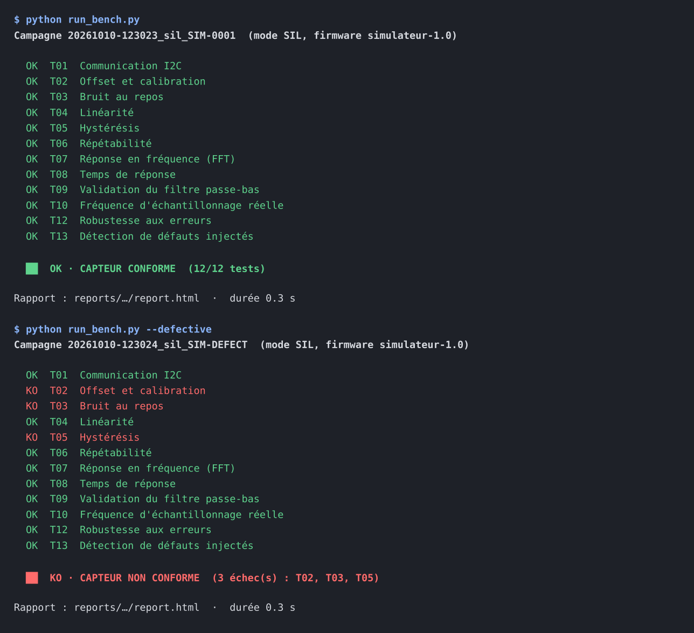

# Banc de test automatisé pour capteurs · Formation pratique


Une formation complète, pas à pas, pour concevoir un **banc de test automatisé de capteur** : du simulateur au matériel réel, du traitement du signal à l'intégration continue. Le capteur étudié est l'accéléromètre **MPU6050**, piloté par un **ESP32**.

Le banc stimule le capteur avec des grandeurs connues (inclinaison par servomoteur, vibration par moteur vibreur), traite son signal, le compare à des critères chiffrés et rend un **verdict OK / KO** avec rapport et traçabilité.



> **Mes résultats** (simulation et matériel) : voir la branche [`mes-essais`](https://github.com/ONS0BAHRI/sensor-test-bench/tree/mes-essais). La branche `main` reste la formation vierge, à cloner pour refaire les TP.

## Ce que vous allez apprendre

- Concevoir un test de capteur : stimulus de référence, méthode, critère d'acceptation.
- Caractériser un capteur : offset, bruit, linéarité, hystérésis, répétabilité, réponse en fréquence, temps de réponse.
- Appliquer le traitement du signal : filtre de Butterworth, FFT, enveloppe, régression, détection de défauts.
- Développer en simulation (SIL) puis valider sur le matériel (HIL) avec les mêmes tests.
- Automatiser : séquence de test, rapports, base de traçabilité, intégration continue.
- Concevoir la carte électronique du banc et découvrir les outils industriels (MATLAB, LabVIEW, TestStand).

## Parcours

| Module | Contenu | Matériel | Statut |
|---|---|---|---|
| [1 · Introduction](formation/01-introduction/README.md) | Principe d'un banc de test, architecture SIL / HIL, vocabulaire | Aucun | terminé |
| [2 · Installation](formation/02-installation/README.md) | Environnement Python, 44 tests, première campagne | Aucun | terminé |
| [3 · Simulateur](formation/03-simulateur/README.md) | Interface commune, modèle physique et ses imperfections | Aucun | à faire |
| [4 · Traitement du signal](formation/04-traitement-du-signal/README.md) | Filtres, FFT, enveloppe, régression, tests unitaires | Aucun | à faire |
| [5 · Tests du capteur](formation/05-tests-du-capteur/README.md) | 13 travaux pratiques, détaillés ci-dessous | Aucun, puis banc | à faire |
| [6 · Automatisation](formation/06-automatisation/README.md) | Séquence de fin de ligne, rapports, SQLite, intégration continue | Aucun | à faire |
| [7 · Matériel et firmware](formation/07-materiel-et-firmware/README.md) | Câblage, montage, firmware ESP32, protocole série | Banc | à faire |
| [8 · Simulation et réel](formation/08-simulation-vs-reel/README.md) | Campagne réelle, comparaison, analyse des écarts | Banc | à faire |
| [9 · Carte PCB](formation/09-carte-pcb/README.md) | Spécification, nomenclature, points de test, validation | Proteus, banc | à faire |
| [10 · Outils industriels](formation/10-outils-industriels/README.md) | MATLAB, LabVIEW, TestStand appliqués au projet | Logiciels | à faire |
| [11 · Intelligence artificielle](formation/11-intelligence-artificielle/README.md) | Détection d'anomalies et classification des défauts | Aucun, puis banc | à développer |
| [12 · Démo et présentation](formation/12-demo-et-presentation/README.md) | Photos, vidéo, présentation | Banc | à faire |

### Les travaux pratiques du module 5

| TP | Test | Résultat de référence (simulation) | Statut |
|---|---|---|---|
| [TP01](formation/05-tests-du-capteur/TP01-communication-i2c/README.md) | Communication I2C | WHO_AM_I = 0x68 | à faire |
| [TP02](formation/05-tests-du-capteur/TP02-offset-et-calibration/README.md) | Offset et calibration | Offset brut max 45 mg, résidu < 0,2 mg | à faire |
| [TP03](formation/05-tests-du-capteur/TP03-bruit/README.md) | Bruit au repos | 4,0 mg, SNR 47,8 dB | à faire |
| [TP04](formation/05-tests-du-capteur/TP04-linearite/README.md) | Linéarité | R² = 0,9999, erreur 0,22 % PE | à faire |
| [TP05](formation/05-tests-du-capteur/TP05-hysteresis/README.md) | Hystérésis | 14,4 mg | à faire |
| [TP06](formation/05-tests-du-capteur/TP06-repetabilite/README.md) | Répétabilité | 0,21 mg sur 10 cycles | à faire |
| [TP07](formation/05-tests-du-capteur/TP07-reponse-en-frequence/README.md) | Réponse en fréquence (FFT) | Erreur max 0,002 Hz | à faire |
| [TP08](formation/05-tests-du-capteur/TP08-temps-de-reponse/README.md) | Temps de réponse | Établi en 70 ms | à faire |
| [TP09](formation/05-tests-du-capteur/TP09-filtre-numerique/README.md) | Filtre numérique | Bruit réduit de 75,7 % | à faire |
| [TP10](formation/05-tests-du-capteur/TP10-echantillonnage/README.md) | Échantillonnage | 500,0 Hz, gigue 1,0 % | à faire |
| [TP11](formation/05-tests-du-capteur/TP11-derive-thermique/README.md) | Dérive thermique | Procédure à écrire | à développer |
| [TP12](formation/05-tests-du-capteur/TP12-robustesse/README.md) | Robustesse | 4 erreurs gérées | à faire |
| [TP13](formation/05-tests-du-capteur/TP13-detection-de-defauts/README.md) | Détection de défauts | 5 défauts sur 5, 0 fausse alarme | à faire |

## Démarrage rapide

```bash
git clone https://github.com/ONS0BAHRI/sensor-test-bench.git
cd sensor-test-bench
python -m venv .venv
.venv\Scripts\activate                 # Windows (Linux / macOS : source .venv/bin/activate)
pip install -r requirements.txt

pytest                                 # 44 tests
python run_bench.py                    # campagne en simulation
python run_bench.py --defective        # le banc rejette un capteur défectueux
python run_bench.py --mode hil --port COM3 --docs   # campagne sur le vrai banc
```

Le détail de chaque commande est dans le [module 2](formation/02-installation/README.md).

## Matériel

ESP32 DevKit, module GY-521 (MPU6050), servo SG90 ou MG90S, mini moteur vibreur 3 V, transistor 2N2222, diode, résistance, alimentation 5 V. Liste complète, câblage et montage : [module 7](formation/07-materiel-et-firmware/README.md). Carte électronique dédiée : [module 9](formation/09-carte-pcb/README.md).

## Structure du dépôt

```text
sensor-test-bench/
├── formation/                 # la formation : un dossier par module, un dossier par TP
├── bench/                     # interface du banc, simulateur, pilote série, procédures de test
├── processing/                # traitement du signal
├── report/                    # graphiques, rapport HTML, traçabilité SQLite
├── config/limits.yaml         # seuils et paramètres de tous les tests
├── firmware/sensor_bench/     # firmware ESP32
├── tests/                     # 44 tests pytest et faux ESP32
├── tools/                     # affichage en direct, comparaison de campagnes, étapes TestStand
├── matlab/                    # TP refaits en MATLAB / Octave
├── assets/                    # images du README
├── .github/workflows/ci.yml   # intégration continue
└── run_bench.py               # campagne complète en une commande
```

## Comment suivre la formation

**Ordre.** Les modules 1 à 6 se font sans matériel. Le module 5 se fait deux fois : en simulation d'abord, puis sur le vrai capteur après le module 7.

**Statuts.** Chaque module et chaque TP affiche un statut : `à faire`, `en cours`, `terminé` ou `à développer`. Mettez-le à jour dans la fiche et dans les tableaux ci-dessus.

**Ce que vous ajoutez.** Les blocs **À compléter** indiquent ce qui vient de votre propre travail : graphiques réels (`images/hil.png`), tableaux de mesures, analyses, photos. Les graphiques de simulation (`images/sil.png`) servent de référence.

**Versionner au fur et à mesure.** Un commit par étape terminée garde un historique lisible, par exemple :

```bash
git add formation/05-tests-du-capteur/TP03-bruit
git commit -m "TP03 : résultats sur le vrai capteur et analyse"
git push
```

Les changements notables sont consignés dans [CHANGELOG.md](CHANGELOG.md).

## Limites connues

- Le servo n'est pas un instrument de référence : son jeu et son erreur de position limitent la précision des tests d'inclinaison.
- Le temps de réponse mesuré est celui de la chaîne complète, dominé par le servo.
- La réponse en fréquence est testée jusqu'à 40 Hz (vibreur, échantillonnage à 500 Hz).
- Les résultats de référence viennent du simulateur ; seuls les essais sur le matériel font foi.

## Licence

Code sous licence MIT, voir [LICENSE](LICENSE). Vous pouvez réutiliser et adapter ce projet en citant la source.

## Auteur

**Ons BAHRI** · [GitHub](https://github.com/ONS0BAHRI) · [Portfolio](https://github.com/ONS0BAHRI/Ons-BAHRI-Portfolio)
