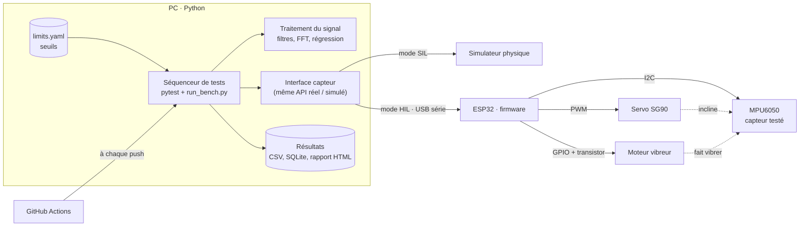

[Formation](../../README.md) › Module 1

# Module 1 · Introduction

**Statut :** à faire

Ce module présente ce que vous allez construire, le principe d'un banc de test de capteur et le vocabulaire utilisé dans toute la formation.

## 1. Ce que vous allez construire

Un banc de test complet pour l'accéléromètre MPU6050. Le banc **stimule** le capteur avec des grandeurs connues, **mesure** sa réponse, la **compare** à des critères chiffrés et rend un **verdict OK ou KO** avec un rapport.

## 2. Le principe d'un banc de test

Tester un capteur, c'est toujours suivre le même schéma :

1. **Appliquer un stimulus de référence**, dont on connaît la valeur exacte.
2. **Mesurer** ce que le capteur renvoie.
3. **Comparer** la mesure à ce qu'elle devrait être, avec une tolérance chiffrée.
4. **Décider** OK ou KO, et **tracer** le résultat.

Dans ce banc, deux stimuli sont utilisés :

| Stimulus | Actionneur | Grandeur attendue |
|---|---|---|
| Inclinaison d'un angle θ | Servomoteur SG90 | Accélération g·sin θ sur l'axe X, g·cos θ sur l'axe Z |
| Vibration modulée à une fréquence f | Moteur vibreur allumé et éteint f fois par seconde | Un pic à f dans le spectre de l'enveloppe |

## 3. Architecture

**Le choix central : une interface commune.** Les procédures de test ne parlent qu'à une interface (`bench/base.py`). Deux classes l'implémentent :

- `SimulatedSensor` : un modèle physique du banc, avec ses imperfections (mode **SIL**, *Software-in-the-Loop*).
- `RealSensor` : le pilote série qui dialogue avec l'ESP32 (mode **HIL**, *Hardware-in-the-Loop*).

On développe et on valide tout en simulation, puis on passe au vrai matériel sans réécrire un seul test. C'est la démarche utilisée dans l'industrie automobile et aéronautique.

## 4. Vocabulaire

| Terme | Définition | Où il intervient |
|---|---|---|
| DUT (*Device Under Test*) | L'appareil testé | Le MPU6050 |
| Justesse | La moyenne des mesures est-elle proche de la valeur vraie ? | TP02, TP04 |
| Fidélité / répétabilité | Les mesures répétées sont-elles proches entre elles ? | TP06 |
| Reproductibilité | Même résultat dans d'autres conditions | TP06, pour aller plus loin |
| Offset | Valeur lue quand la grandeur vaut zéro | TP02 |
| Sensibilité / gain | Rapport sortie / entrée (16384 LSB/g à ±2 g) | TP04 |
| Pleine échelle (PE) | Plage maximale mesurable (±2 g) | TP04 |
| Résolution | Plus petite variation codable (1 LSB ≈ 61 µg) | TP03 |
| Linéarité | Écart à la droite idéale, en % de la PE | TP04 |
| Hystérésis | La mesure dépend du sens d'arrivée | TP05 |
| Bruit, SNR | Variation aléatoire ; rapport signal sur bruit en dB | TP03 |
| Shannon-Nyquist | On ne mesure que les fréquences inférieures à fe / 2 | TP07, TP10 |
| Temps de réponse | Délai pour suivre un changement brusque | TP08 |
| Dérive | Variation lente avec le temps ou la température | TP11 |
| Étalonnage / ajustage | Comparer à une référence / corriger | TP02 |
| Faux positif / faux négatif | Rejeter un bon capteur / accepter un mauvais | Module 6 |

Un faux négatif (accepter un mauvais capteur) coûte beaucoup plus cher qu'un faux positif : le défaut part chez le client. C'est pourquoi l'intégration continue vérifie que le banc **rejette** un capteur défectueux.

## 5. Organisation de la formation

| Étape | Modules | Matériel nécessaire |
|---|---|---|
| Comprendre et pratiquer en simulation | 1 à 6 | Aucun : un PC suffit |
| Passer au vrai capteur | 7 et 8 | Banc ESP32 + MPU6050 |
| Industrialiser | 9 à 12 | Proteus pour la carte, outils industriels en option |

## Checklist

- [ ] J'ai compris le principe stimulus → mesure → comparaison → verdict
- [ ] Je sais expliquer la différence entre SIL et HIL
- [ ] Je connais les termes du tableau de vocabulaire

---

[Sommaire](../../README.md) · [Module 2 · Installation →](../02-installation/README.md)
