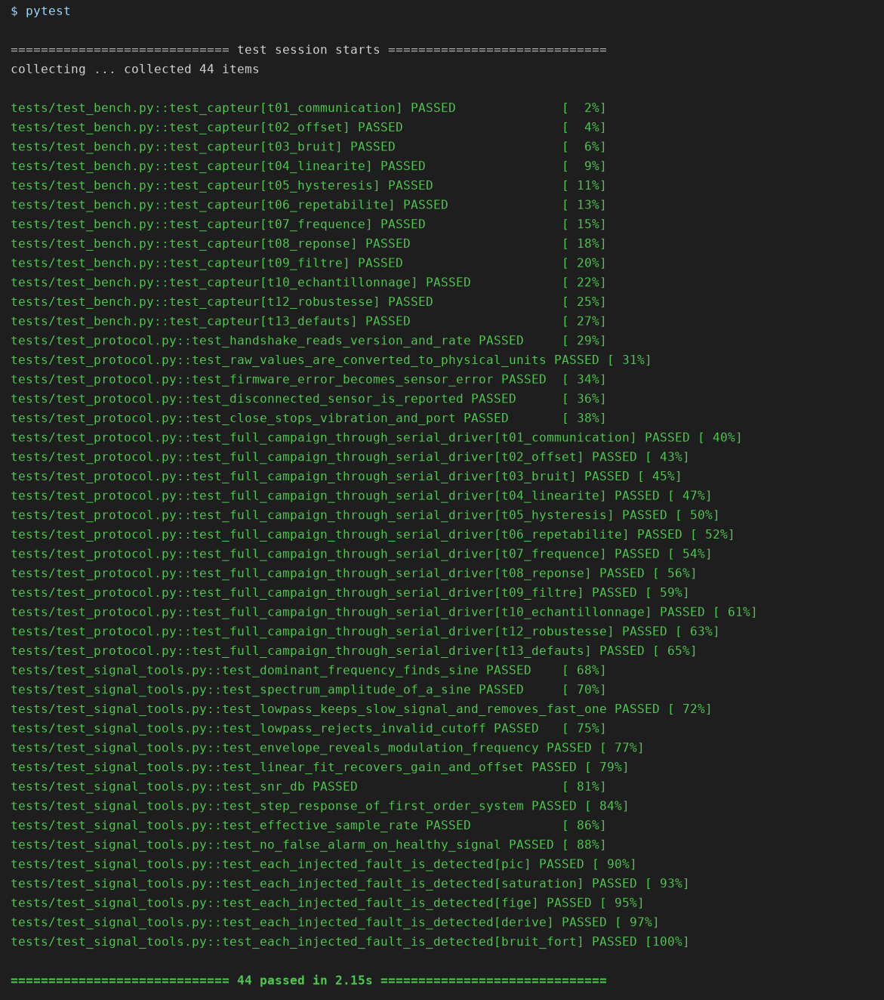
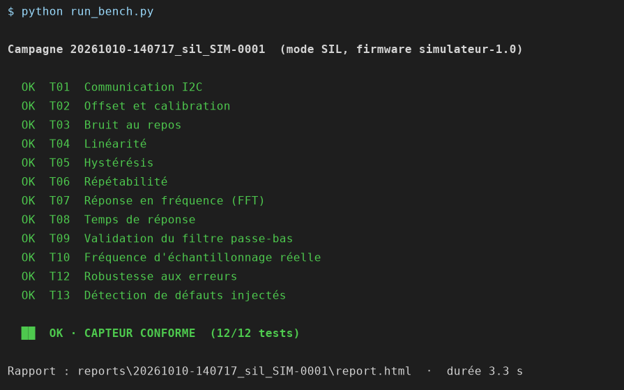
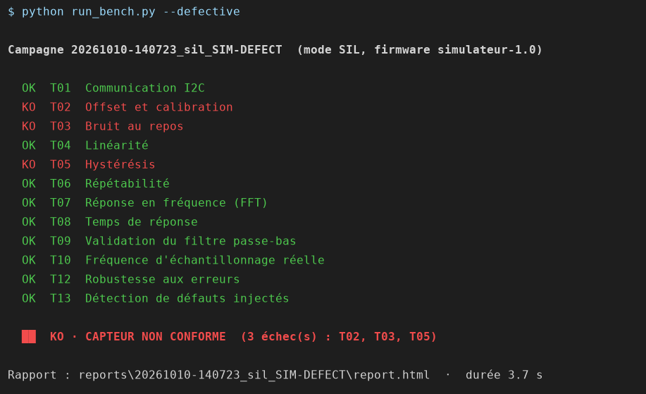

[Formation](../../README.md) › Module 2

# Module 2 · Installation et première campagne

**Statut :** terminé

À la fin de ce module, les 44 tests automatiques passent sur votre PC et vous avez ouvert votre premier rapport de campagne.

## 1. Prérequis

| Outil | Version | Rôle |
|---|---|---|
| Python | 3.11 ou plus récent | Tout le code du banc |
| Git | récent | Récupérer et versionner le projet |
| Un éditeur | VS Code conseillé | Lire et modifier le code |
| DB Browser for SQLite | facultatif | Explorer la base de résultats |

Sous Windows, cochez « Add Python to PATH » pendant l'installation de Python.

## 2. Récupérer le projet

```bash
git clone https://github.com/ONS0BAHRI/sensor-test-bench.git
cd sensor-test-bench
```

## 3. Créer l'environnement Python

Un environnement virtuel isole les bibliothèques du projet de celles du système.

```bash
python -m venv .venv
.venv\Scripts\activate            # Windows
source .venv/bin/activate         # Linux / macOS
pip install -r requirements.txt
```

## 4. Vérifier l'installation

```bash
pytest
```

Résultat attendu : `44 passed`. Les tests se répartissent en trois familles :

| Fichier | Nombre | Ce qu'il vérifie |
|---|---|---|
| `tests/test_signal_tools.py` | 15 | Les outils de traitement du signal, sur des signaux dont la réponse est connue |
| `tests/test_protocol.py` | 17 | Le pilote série, face à un faux ESP32 qui rejoue le protocole du firmware |
| `tests/test_bench.py` | 12 | Les tests du capteur, en simulation ou sur le vrai matériel |

## 5. Lancer une première campagne

```bash
python run_bench.py
```

Le banc enchaîne les tests et affiche le verdict. Ouvrez ensuite le rapport indiqué à la fin, `reports/<campagne>/report.html`, dans un navigateur.

Puis lancez la même campagne sur un capteur simulé défectueux :

```bash
python run_bench.py --defective
```

Le verdict doit être **KO**, avec la liste des tests en échec.

## 6. Ce que produit une campagne

| Fichier | Contenu |
|---|---|
| `reports/<campagne>/report.html` | Rapport autonome avec un graphique par test |
| `reports/<campagne>/summary.md` | Tableau des résultats en Markdown |
| `reports/<campagne>/results.json` | Résultats lisibles par un programme |
| `reports/<campagne>/raw/*.csv` | Données brutes de chaque test |
| `reports/results.db` | Historique de toutes les campagnes (SQLite) |

Le dossier `reports/` est ignoré par Git : ce sont des résultats générés, pas du code.

## 7. Dépannage

| Symptôme | Solution |
|---|---|
| `python` introuvable | Réinstaller Python avec « Add Python to PATH », ou utiliser `py` sous Windows |
| `No module named ...` | L'environnement virtuel n'est pas activé, ou `pip install -r requirements.txt` n'a pas été lancé |
| Activation refusée sous PowerShell | `Set-ExecutionPolicy -Scope CurrentUser RemoteSigned`, puis relancer l'activation |

## Vos résultats

Installation sous Windows 11, Python 3.12.6 (numpy 2.5, scipy 1.18, matplotlib 3.11, pytest 9.1).

| Étape | Résultat |
|---|---|
| `pytest` | **44 tests réussis** (12 banc, 17 protocole série, 15 traitement du signal) |
| `python run_bench.py` | **OK · capteur conforme**, 12/12 tests, 3,5 s |
| `python run_bench.py --defective` | **KO · capteur non conforme**, 3 échecs : T02, T03, T05 |







**Pourquoi le capteur défectueux est rejeté :**

| Test | Mesure du capteur défectueux | Critère | Capteur conforme |
|---|---|---|---|
| T02 Offset | offset brut X = 0,210 g | ≤ 0,15 g | 0,035 g |
| T03 Bruit | écart-type 13,0 mg, SNR 37,6 dB | ≤ 10 mg et ≥ 40 dB | 4,0 mg, 47,8 dB |
| T05 Hystérésis | écart montée/descente 57,6 mg | ≤ 20 mg | 14,4 mg |

Les autres tests passent : un capteur défectueux n'est pas mauvais partout, d'où l'intérêt d'une campagne complète.

## Checklist

- [x] `pytest` affiche 44 tests réussis
- [x] Campagne normale : verdict OK, rapport ouvert
- [x] Campagne `--defective` : verdict KO
- [x] Captures ajoutées

---

[← Module 1 · Introduction](../01-introduction/README.md) · [Sommaire](../../README.md) · [Module 3 · Simulateur →](../03-simulateur/README.md)
