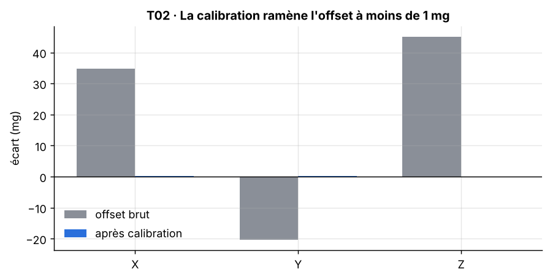
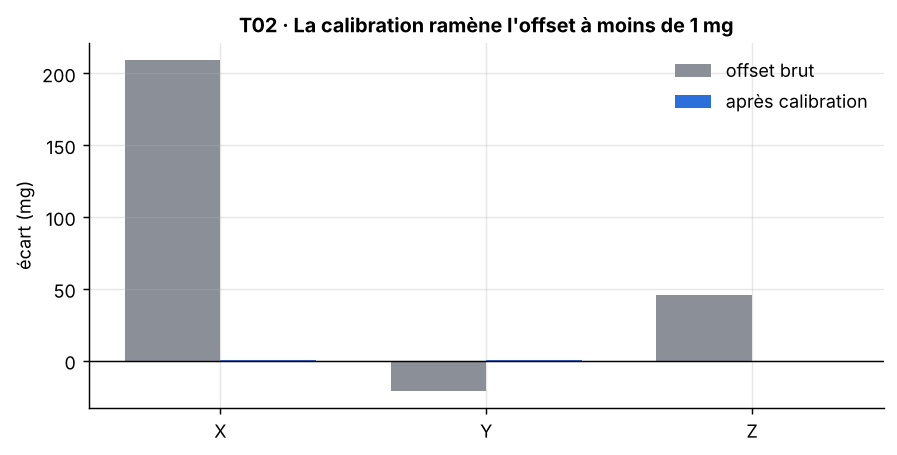

[Formation](../../../README.md) › [5 · Tests du capteur](../README.md) › TP02

# TP02 · Offset et calibration

**Statut :** à faire

| | |
|---|---|
| **Objectif** | Mesurer le décalage à zéro de chaque axe, vérifier qu'il respecte la tolérance, puis vérifier que la calibration le corrige. |
| **Procédure** | `t02_offset` dans [`bench/procedures.py`](../../../bench/procedures.py) |
| **Seuils** | section `T02_offset` de [`config/limits.yaml`](../../../config/limits.yaml) |
| **Modes** | simulation (SIL) et vrai capteur (HIL) |

## 1. Pourquoi ce test

Tout capteur a un zéro décalé. On le mesure pour vérifier qu'il reste dans la tolérance du fabricant, puis on le corrige par logiciel. Dans l'industrie, ces coefficients de calibration sont souvent écrits dans la mémoire du produit à la fin du test.

## 2. Notions à connaître

- Offset (biais, zéro) : valeur lue quand la grandeur mesurée vaut zéro.
- Un accéléromètre au repos mesure la gravité : à plat, on attend 0 g sur X et Y, et 1 g sur Z.
- Étalonner, c'est comparer à une référence. Ajuster, c'est corriger. Ce TP fait les deux.
- Datasheet MPU6050 : offset typique de ±50 mg sur X et Y, ±80 mg sur Z.

## 3. Conditions de mesure

Capteur à plat (servo à 0°), immobile, vibreur arrêté.

## 4. Méthode

1. Placer le servo à 0° et attendre la stabilisation.
2. Acquérir 1 000 mesures et calculer la moyenne de chaque axe.
3. Offset brut = moyenne mesurée − valeur attendue (0, 0, 1 g).
4. Acquérir 1 000 nouvelles mesures, leur soustraire l'offset brut : c'est le résidu après calibration.
5. Vérifier l'offset brut et le résidu par rapport aux seuils.

## 5. Le code

La procédure pilote le banc, calcule les indicateurs et compare aux seuils. Elle est identique en simulation et sur le vrai capteur.

<details>
<summary>Voir le code de <code>t02_offset</code></summary>

```python
def t02_offset(bench: SensorInterface, lim: dict) -> TestResult:
    c = lim["T02_offset"]
    bench.set_angle(0)
    bench.wait(lim["acquisition"]["settle_s"])
    expected = np.array([0.0, 0.0, 1.0])                         # capteur à plat : 1 g sur Z

    m1 = bench.read(c["n"])
    raw_offset = np.array([m1.ax.mean(), m1.ay.mean(), m1.az.mean()]) - expected

    m2 = bench.read(c["n"])                                      # nouvelle mesure, corrigée
    residual = np.array([m2.ax.mean(), m2.ay.mean(), m2.az.mean()]) - raw_offset - expected

    passed = bool(np.all(np.abs(raw_offset) <= c["max_raw_offset_g"])
                  and np.all(np.abs(residual) <= c["max_residual_g"]))
    measures = {f"offset brut {a} (g)": float(v) for a, v in zip("XYZ", raw_offset)}
    measures.update({f"résidu {a} après calibration (g)": float(v) for a, v in zip("XYZ", residual)})
    return TestResult("T02", "Offset et calibration", passed,
                      f"|offset brut| ≤ {c['max_raw_offset_g']} g et |résidu| ≤ {c['max_residual_g']} g",
                      measures, {"raw_offset": raw_offset, "residual": residual},
                      {"flat_1": m1, "flat_2": m2})
```

</details>

## 6. Critère d'acceptation

Extrait de `config/limits.yaml` :

```yaml
T02_offset:
  n: 1000
  max_raw_offset_g: 0.15
  max_residual_g: 0.05
```

Critère vérifié : **|offset brut| ≤ 0.15 g et |résidu| ≤ 0.05 g**.

## 7. Lancer le TP

```bash
pytest tests/test_bench.py -k t02 -s                         # simulation
pytest tests/test_bench.py -k t02 -s --mode hil --port COM3  # vrai capteur (Linux : /dev/ttyUSB0)
python run_bench.py --mode hil --port COM3 --docs              # campagne complète, graphiques rangés dans les TP
```

## 8. Résultat de référence (simulation)

| Mesure | Valeur |
|---|---|
| offset brut X (g) | 0.03488 |
| offset brut Y (g) | -0.02033 |
| offset brut Z (g) | 0.04514 |
| résidu X après calibration (g) | 0.0001851 |
| résidu Y après calibration (g) | 0.0001588 |
| résidu Z après calibration (g) | -0.0001881 |

Verdict : **OK**.



**Lire le graphique.** Barres grises : offset brut de chaque axe. Barres bleues : ce qu'il reste après correction. Les bleues doivent être presque nulles.

Le même test sur le capteur simulé défectueux (`python run_bench.py --defective`) passe KO :



## 9. Ce qui serait anormal

- Une barre bleue non nulle : la calibration ne fonctionne pas, ou le capteur a bougé entre les deux acquisitions.
- Une barre grise énorme sur Z : le capteur n'est pas à plat (vérifier le zéro mécanique du servo).

## 10. Vos résultats sur le vrai capteur

> **À compléter** après la campagne sur le matériel. Ajoutez le graphique, remplissez le tableau et écrivez votre analyse.

**Ce à quoi s'attendre.** L'offset réel dépend de votre exemplaire de capteur et du montage : un support pas tout à fait horizontal ajoute un décalage sur X ou Y. Notez l'angle de votre support si vous pouvez le mesurer.

| Mesure | Simulation | Vrai capteur | Écart / commentaire |
|---|---|---|---|
| offset brut X (g) | 0.03488 | | |
| offset brut Y (g) | -0.02033 | | |
| offset brut Z (g) | 0.04514 | | |
| résidu X après calibration (g) | 0.0001851 | | |
| résidu Y après calibration (g) | 0.0001588 | | |
| résidu Z après calibration (g) | -0.0001881 | | |

<!-- Après la campagne réelle, retirez cette ligne de commentaire et la dernière pour afficher le graphique :

-->

**Analyse :** *(Que montrent vos mesures ? Quels écarts avec la simulation, et pourquoi ? Le défaut vient-il du capteur ou du banc ?)*

## 11. Pour aller plus loin

- Comparez les offsets de deux modules différents : ils ne sont jamais identiques, d'où une calibration par pièce.
- Écrivez les offsets dans un fichier JSON et appliquez-les automatiquement dans les autres tests.

## 12. Questions de révision

**Pourquoi Z vaut-il 1 g et non 0 ?**

<details>
<summary>Réponse</summary>

Parce qu'un accéléromètre mesure la force qui le retient contre la gravité : au repos sur une table, il mesure 1 g vers le haut.

</details>

**Pourquoi faire une seconde acquisition pour vérifier la calibration ?**

<details>
<summary>Réponse</summary>

Pour ne pas vérifier la correction sur les mêmes données que celles qui ont servi à la calculer : sinon, le résidu serait nul par construction.

</details>

## Checklist de fin de TP

- [ ] Test lancé et compris en simulation
- [ ] Test lancé sur le vrai capteur
- [ ] Graphique réel ajouté (`images/hil.png`) et affiché ci-dessus
- [ ] Tableau des résultats réels rempli
- [ ] Analyse rédigée
- [ ] Statut mis à jour ici et dans le [sommaire](../../../README.md#parcours)

---

[← TP01](../TP01-communication-i2c/README.md) · [Sommaire du module](../README.md) · [TP03 →](../TP03-bruit/README.md)
