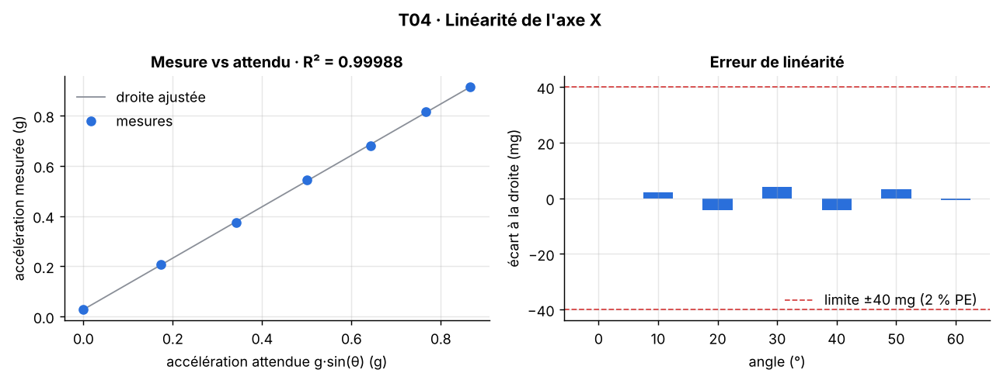

[Formation](../../../README.md) › [5 · Tests du capteur](../README.md) › TP04

# TP04 · Linéarité

**Statut :** à faire

| | |
|---|---|
| **Objectif** | Vérifier que la sortie du capteur est proportionnelle à la grandeur mesurée, et obtenir le gain et l'offset de calibration. |
| **Procédure** | `t04_linearite` dans [`bench/procedures.py`](../../../bench/procedures.py) |
| **Seuils** | section `T04_linearite` de [`config/limits.yaml`](../../../config/limits.yaml) |
| **Modes** | simulation (SIL) et vrai capteur (HIL) |

## 1. Pourquoi ce test

C'est le test central d'un capteur. Si la sortie est linéaire, deux coefficients (gain et offset) suffisent à le calibrer sur toute sa plage.

## 2. Notions à connaître

- Stimulus de référence : quand le capteur est incliné d'un angle θ, l'accélération attendue sur X vaut g·sin θ.
- Régression linéaire (moindres carrés) : on cherche la droite mesure = gain × attendu + offset.
- Coefficient de détermination R² : 1 pour des points parfaitement alignés.
- Erreur de linéarité : plus grand écart à la droite, exprimé en % de la pleine échelle (PE = 2 g ici).

## 3. Conditions de mesure

Servo de 0° à 60° par pas de 10°, toujours approché par le même sens (pour ne pas mesurer l'hystérésis). 500 mesures par angle.

## 4. Méthode

1. Placer le servo à −10° pour partir toujours du même côté.
2. Pour chaque angle : positionner, attendre la stabilisation, mesurer la moyenne de X.
3. Calculer les valeurs attendues g·sin θ.
4. Régression linéaire : gain, offset, R², écarts à la droite.
5. Comparer R² et l'erreur maximale aux seuils.

## 5. Le code

La procédure pilote le banc, calcule les indicateurs et compare aux seuils. Elle est identique en simulation et sur le vrai capteur.

<details>
<summary>Voir le code de <code>t04_linearite</code></summary>

```python
def t04_linearite(bench: SensorInterface, lim: dict) -> TestResult:
    c = lim["T04_linearite"]
    angles = np.array(c["angles_deg"], float)
    bench.set_angle(-10)                                         # approche toujours par le même sens
    bench.wait(lim["acquisition"]["settle_s"])
    means, raws = [], {}
    for a in angles:
        mean, m = _static_mean(bench, a, lim)
        means.append(mean)
        raws[f"angle_{int(a):+03d}"] = m
    expected = np.sin(np.radians(angles))                        # en g
    fit = sp.linear_fit(expected, np.array(means))
    err_pct = fit.max_residual / c["full_scale_g"] * 100
    passed = fit.r2 >= c["min_r2"] and err_pct <= c["max_error_pct_fs"]
    return TestResult("T04", "Linéarité", passed,
                      f"R² ≥ {c['min_r2']} et erreur ≤ {c['max_error_pct_fs']} % PE",
                      {"R²": fit.r2, "erreur max (% PE)": err_pct, "gain mesuré": fit.gain,
                       "offset mesuré (g)": fit.offset},
                      {"angles": angles, "expected": expected, "measured": np.array(means),
                       "gain": fit.gain, "offset": fit.offset, "residuals": fit.residuals}, raws)
```

</details>

## 6. Critère d'acceptation

Extrait de `config/limits.yaml` :

```yaml
T04_linearite:
  angles_deg:
  - 0
  - 10
  - 20
  - 30
  - 40
  - 50
  - 60
  min_r2: 0.99
  max_error_pct_fs: 2.0
  full_scale_g: 2.0
```

Critère vérifié : **R² ≥ 0.99 et erreur ≤ 2.0 % PE**.

## 7. Lancer le TP

```bash
pytest tests/test_bench.py -k t04 -s                         # simulation
pytest tests/test_bench.py -k t04 -s --mode hil --port COM3  # vrai capteur (Linux : /dev/ttyUSB0)
python run_bench.py --mode hil --port COM3 --docs              # campagne complète, graphiques rangés dans les TP
```

## 8. Résultat de référence (simulation)

| Mesure | Valeur |
|---|---|
| R² | 0.9999 |
| erreur max (% PE) | 0.2211 |
| gain mesuré | 1.023 |
| offset mesuré (g) | 0.0279 |

Verdict : **OK**.



**Lire le graphique.** À gauche, les points doivent être alignés sur la droite. À droite, chaque barre est l'écart d'un point à la droite : les écarts doivent rester petits et sans forme particulière.

## 9. Ce qui serait anormal

- Des écarts en forme d'arc : non-linéarité réelle, ou modèle g·sin θ mal adapté (axe de rotation mal aligné).
- Un seul point très écarté : mauvaise fixation ou servo bloqué à cet angle.

## 10. Vos résultats sur le vrai capteur

> **À compléter** après la campagne sur le matériel. Ajoutez le graphique, remplissez le tableau et écrivez votre analyse.

**Ce à quoi s'attendre.** Les écarts seront probablement plus grands et irréguliers : l'erreur de position d'un servo SG90 est de l'ordre du degré, ce qui fait plusieurs mg. C'est une erreur du banc, pas du capteur. Notez-le dans votre analyse.

| Mesure | Simulation | Vrai capteur | Écart / commentaire |
|---|---|---|---|
| R² | 0.9999 | | |
| erreur max (% PE) | 0.2211 | | |
| gain mesuré | 1.023 | | |
| offset mesuré (g) | 0.0279 | | |

<!-- Après la campagne réelle, retirez cette ligne de commentaire et la dernière pour afficher le graphique :

-->

**Analyse :** *(Que montrent vos mesures ? Quels écarts avec la simulation, et pourquoi ? Le défaut vient-il du capteur ou du banc ?)*

## 11. Pour aller plus loin

- Ajoutez les angles négatifs (−60° à 0°) et vérifiez la symétrie.
- Utilisez le gain et l'offset obtenus pour corriger les mesures des autres TP.

## 12. Questions de révision

**Quelle différence entre une erreur de gain et une non-linéarité ?**

<details>
<summary>Réponse</summary>

L'erreur de gain change la pente de la droite : elle se corrige avec un coefficient. La non-linéarité est une courbure : elle ne se corrige pas avec deux coefficients.

</details>

**Pourquoi approcher chaque angle toujours par le même sens ?**

<details>
<summary>Réponse</summary>

Pour ne pas mélanger l'hystérésis du servo avec la linéarité du capteur. L'hystérésis est mesurée séparément au TP05.

</details>

## Checklist de fin de TP

- [ ] Test lancé et compris en simulation
- [ ] Test lancé sur le vrai capteur
- [ ] Graphique réel ajouté (`images/hil.png`) et affiché ci-dessus
- [ ] Tableau des résultats réels rempli
- [ ] Analyse rédigée
- [ ] Statut mis à jour ici et dans le [sommaire](../../../README.md#parcours)

---

[← TP03](../TP03-bruit/README.md) · [Sommaire du module](../README.md) · [TP05 →](../TP05-hysteresis/README.md)
