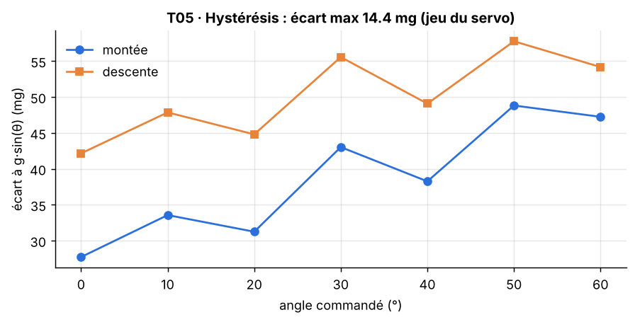

[Formation](../../../README.md) › [5 · Tests du capteur](../README.md) › TP05

# TP05 · Hystérésis

**Statut :** à faire

| | |
|---|---|
| **Objectif** | Vérifier que la mesure ne dépend pas du sens dans lequel on arrive à une position. |
| **Procédure** | `t05_hysteresis` dans [`bench/procedures.py`](../../../bench/procedures.py) |
| **Seuils** | section `T05_hysteresis` de [`config/limits.yaml`](../../../config/limits.yaml) |
| **Modes** | simulation (SIL) et vrai capteur (HIL) |

## 1. Pourquoi ce test

Dans un vrai système, la grandeur monte et descend. Si la mesure dépend du sens, l'utilisateur obtient deux valeurs différentes pour la même position.

## 2. Notions à connaître

- Hystérésis : différence de mesure entre une approche montante et une approche descendante.
- Jeu mécanique : petit déplacement libre dans les engrenages d'un servo, qui crée une hystérésis du banc.
- Ordre de grandeur : à 0°, 1° d'inclinaison correspond à environ 17,5 mg sur X.

## 3. Conditions de mesure

Mêmes angles que le TP04, parcourus en montée (0° → 60°) puis en descente (60° → 0°).

## 4. Méthode

1. Partir de −10°, mesurer chaque angle en montant.
2. Partir de 70°, mesurer chaque angle en descendant.
3. Calculer l'écart montée / descente à chaque angle et garder le plus grand.

## 5. Le code

La procédure pilote le banc, calcule les indicateurs et compare aux seuils. Elle est identique en simulation et sur le vrai capteur.

<details>
<summary>Voir le code de <code>t05_hysteresis</code></summary>

```python
def t05_hysteresis(bench: SensorInterface, lim: dict) -> TestResult:
    c = lim["T05_hysteresis"]
    angles = list(c["angles_deg"])
    bench.set_angle(angles[0] - 10)
    bench.wait(lim["acquisition"]["settle_s"])
    up = [_static_mean(bench, a, lim)[0] for a in angles]
    bench.set_angle(angles[-1] + 10)
    bench.wait(lim["acquisition"]["settle_s"])
    down = [_static_mean(bench, a, lim)[0] for a in reversed(angles)][::-1]
    gaps = np.abs(np.array(up) - np.array(down))
    worst = float(gaps.max())
    return TestResult("T05", "Hystérésis", worst <= c["max_gap_g"],
                      f"écart montée/descente ≤ {c['max_gap_g'] * 1000:.0f} mg",
                      {"écart max (mg)": worst * 1000, "à l'angle (°)": angles[int(gaps.argmax())]},
                      {"angles": np.array(angles), "up": np.array(up), "down": np.array(down)})
```

</details>

## 6. Critère d'acceptation

Extrait de `config/limits.yaml` :

```yaml
T05_hysteresis:
  angles_deg:
  - 0
  - 10
  - 20
  - 30
  - 40
  - 50
  - 60
  max_gap_g: 0.02
```

Critère vérifié : **écart montée/descente ≤ 20 mg**.

## 7. Lancer le TP

```bash
pytest tests/test_bench.py -k t05 -s                         # simulation
pytest tests/test_bench.py -k t05 -s --mode hil --port COM3  # vrai capteur (Linux : /dev/ttyUSB0)
python run_bench.py --mode hil --port COM3 --docs              # campagne complète, graphiques rangés dans les TP
```

## 8. Résultat de référence (simulation)

| Mesure | Valeur |
|---|---|
| écart max (mg) | 14.43 |
| à l'angle (°) | 0 |

Verdict : **OK**.



**Lire le graphique.** Courbe bleue : montée. Courbe orange : descente. L'espace vertical entre les deux est l'hystérésis.

Le même test sur le capteur simulé défectueux (`python run_bench.py --defective`) passe KO :


## 9. Ce qui serait anormal

- Un écart qui augmente au fil des campagnes : usure mécanique du servo.
- Un écart très différent d'un angle à l'autre : fixation qui glisse.

## 10. Vos résultats sur le vrai capteur

> **À compléter** après la campagne sur le matériel. Ajoutez le graphique, remplissez le tableau et écrivez votre analyse.

**Ce à quoi s'attendre.** Le jeu réel d'un SG90 peut dépasser celui du simulateur : un KO est possible. Les solutions : un servo MG90S à engrenages métal, ou un seuil revu et justifié. Dans les deux cas, expliquez que l'hystérésis vient du banc et non du capteur.

| Mesure | Simulation | Vrai capteur | Écart / commentaire |
|---|---|---|---|
| écart max (mg) | 14.43 | | |
| à l'angle (°) | 0 | | |

<!-- Après la campagne réelle, retirez cette ligne de commentaire et la dernière pour afficher le graphique :

-->

**Analyse :** *(Que montrent vos mesures ? Quels écarts avec la simulation, et pourquoi ? Le défaut vient-il du capteur ou du banc ?)*

## 11. Pour aller plus loin

- Avec le simulateur, trouvez le jeu maximal toléré : `python run_bench.py --backlash 0.55` puis `--backlash 0.6`. Comparez avec votre calcul à la main (20 mg ÷ (2 × 17,5 mg/°) ≈ 0,57°).
- Mesurez l'hystérésis de deux servos différents et comparez-les.

## 12. Questions de révision

**L'hystérésis mesurée vient-elle du capteur ?**

<details>
<summary>Réponse</summary>

Ici, non : elle vient du jeu mécanique du servo. Se demander si l'erreur vient de l'appareil testé ou du banc est l'une des questions les plus importantes d'un testeur.

</details>

**Comment séparer l'hystérésis du capteur de celle du banc ?**

<details>
<summary>Réponse</summary>

Avec une référence indépendante : un second capteur de référence fixé au même endroit, ou un instrument plus précis que le servo.

</details>

## Checklist de fin de TP

- [ ] Test lancé et compris en simulation
- [ ] Test lancé sur le vrai capteur
- [ ] Graphique réel ajouté (`images/hil.png`) et affiché ci-dessus
- [ ] Tableau des résultats réels rempli
- [ ] Analyse rédigée
- [ ] Statut mis à jour ici et dans le [sommaire](../../../README.md#parcours)

---

[← TP04](../TP04-linearite/README.md) · [Sommaire du module](../README.md) · [TP06 →](../TP06-repetabilite/README.md)
