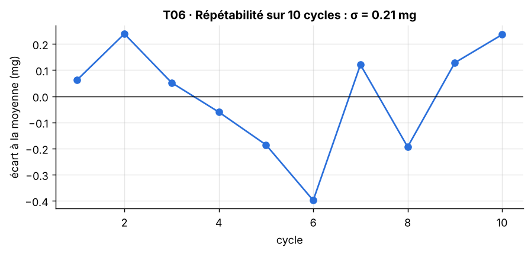

[Formation](../../../README.md) › [5 · Tests du capteur](../README.md) › TP06

# TP06 · Répétabilité

**Statut :** à faire

| | |
|---|---|
| **Objectif** | Vérifier qu'une même consigne donne toujours la même mesure. |
| **Procédure** | `t06_repetabilite` dans [`bench/procedures.py`](../../../bench/procedures.py) |
| **Seuils** | section `T06_repetabilite` de [`config/limits.yaml`](../../../config/limits.yaml) |
| **Modes** | simulation (SIL) et vrai capteur (HIL) |

## 1. Pourquoi ce test

Un client attend la même mesure à chaque fois. C'est aussi un test du banc lui-même : un banc non répétable rend tous les autres résultats douteux.

## 2. Notions à connaître

- Répétabilité : mesures répétées dans les mêmes conditions, à la suite.
- Reproductibilité : mesures dans des conditions différentes (autre jour, autre banc, autre opérateur).
- Écart-type avec ddof = 1 : estimation à partir d'un échantillon (division par n − 1).

## 3. Conditions de mesure

10 cycles 0° → 30°, mesure à 30° à chaque cycle.

## 4. Méthode

1. Répéter 10 fois : servo à 0°, puis à 30°, mesure moyenne à 30°.
2. Calculer l'écart-type et l'étendue (max − min) des 10 valeurs.

## 5. Le code

La procédure pilote le banc, calcule les indicateurs et compare aux seuils. Elle est identique en simulation et sur le vrai capteur.

<details>
<summary>Voir le code de <code>t06_repetabilite</code></summary>

```python
def t06_repetabilite(bench: SensorInterface, lim: dict) -> TestResult:
    c = lim["T06_repetabilite"]
    values = []
    for _ in range(c["cycles"]):
        bench.set_angle(0)
        bench.wait(lim["acquisition"]["settle_s"])
        values.append(_static_mean(bench, c["angle_deg"], lim)[0])
    std = float(np.std(values, ddof=1))
    return TestResult("T06", "Répétabilité", std <= c["max_std_g"],
                      f"écart-type sur {c['cycles']} cycles ≤ {c['max_std_g'] * 1000:.0f} mg",
                      {"écart-type (mg)": std * 1000, "étendue (mg)": (max(values) - min(values)) * 1000},
                      {"values": np.array(values)})
```

</details>

## 6. Critère d'acceptation

Extrait de `config/limits.yaml` :

```yaml
T06_repetabilite:
  cycles: 10
  angle_deg: 30
  max_std_g: 0.01
```

Critère vérifié : **écart-type sur 10 cycles ≤ 10 mg**.

## 7. Lancer le TP

```bash
pytest tests/test_bench.py -k t06 -s                         # simulation
pytest tests/test_bench.py -k t06 -s --mode hil --port COM3  # vrai capteur (Linux : /dev/ttyUSB0)
python run_bench.py --mode hil --port COM3 --docs              # campagne complète, graphiques rangés dans les TP
```

## 8. Résultat de référence (simulation)

| Mesure | Valeur |
|---|---|
| écart-type (mg) | 0.2067 |
| étendue (mg) | 0.6368 |

Verdict : **OK**.



**Lire le graphique.** Chaque point est un cycle. Les points doivent rester proches de 0, sans tendance.

## 9. Ce qui serait anormal

- Une pente régulière : dérive (échauffement du capteur ou du servo).
- Un point isolé : choc ou fixation qui a bougé.

## 10. Vos résultats sur le vrai capteur

> **À compléter** après la campagne sur le matériel. Ajoutez le graphique, remplissez le tableau et écrivez votre analyse.

**Ce à quoi s'attendre.** La répétabilité réelle sera moins bonne qu'en simulation à cause du servo, mais doit rester sous le seuil.

| Mesure | Simulation | Vrai capteur | Écart / commentaire |
|---|---|---|---|
| écart-type (mg) | 0.2067 | | |
| étendue (mg) | 0.6368 | | |

<!-- Après la campagne réelle, retirez cette ligne de commentaire et la dernière pour afficher le graphique :

-->

**Analyse :** *(Que montrent vos mesures ? Quels écarts avec la simulation, et pourquoi ? Le défaut vient-il du capteur ou du banc ?)*

## 11. Pour aller plus loin

- Passez à 100 cycles et tracez l'évolution : vous obtenez un test d'endurance.
- Refaites le TP un autre jour : comparer les deux résultats est un test de reproductibilité.

## 12. Questions de révision

**Répétabilité ou reproductibilité ?**

<details>
<summary>Réponse</summary>

Répétabilité : mêmes conditions, à la suite. Reproductibilité : conditions différentes. Un bon banc doit garantir les deux.

</details>

**Pourquoi revenir à 0° entre chaque mesure ?**

<details>
<summary>Réponse</summary>

Pour que chaque cycle soit un vrai nouveau positionnement. Sinon, on mesurerait seulement le bruit en position fixe.

</details>

## Checklist de fin de TP

- [ ] Test lancé et compris en simulation
- [ ] Test lancé sur le vrai capteur
- [ ] Graphique réel ajouté (`images/hil.png`) et affiché ci-dessus
- [ ] Tableau des résultats réels rempli
- [ ] Analyse rédigée
- [ ] Statut mis à jour ici et dans le [sommaire](../../../README.md#parcours)

---

[← TP05](../TP05-hysteresis/README.md) · [Sommaire du module](../README.md) · [TP07 →](../TP07-reponse-en-frequence/README.md)
