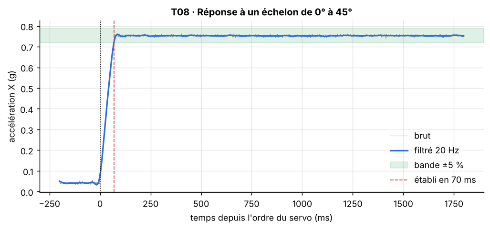

[Formation](../../../README.md) › [5 · Tests du capteur](../README.md) › TP08

# TP08 · Temps de réponse

**Statut :** à faire

| | |
|---|---|
| **Objectif** | Mesurer la vitesse à laquelle la mesure suit un changement brusque d'inclinaison. |
| **Procédure** | `t08_reponse` dans [`bench/procedures.py`](../../../bench/procedures.py) |
| **Seuils** | section `T08_reponse` de [`config/limits.yaml`](../../../config/limits.yaml) |
| **Modes** | simulation (SIL) et vrai capteur (HIL) |

## 1. Pourquoi ce test

Dans un système de contrôle (drone, stabilisation, sécurité), une mesure en retard est une mesure fausse.

## 2. Notions à connaître

- Réponse indicielle : réponse à un échelon (changement brusque de consigne).
- Temps de montée : passage de 10 % à 90 % de la variation.
- Temps d'établissement : instant à partir duquel la mesure reste dans une bande de ±5 % autour de la valeur finale.
- Dépassement : de combien la mesure dépasse la valeur finale avant de se stabiliser.

## 3. Conditions de mesure

Échelon de 0° à 45°. Acquisition continue de 1 000 mesures, l'ordre du servo est donné à la mesure 100.

## 4. Méthode

1. Envoyer la commande `STEP 45 1000` : le firmware acquiert en continu et commande le servo pendant l'acquisition.
2. Filtrer le signal X (passe-bas 20 Hz, aller-retour pour ne pas le retarder).
3. Calculer temps de montée, temps d'établissement et dépassement.

## 5. Le code

La procédure pilote le banc, calcule les indicateurs et compare aux seuils. Elle est identique en simulation et sur le vrai capteur.

<details>
<summary>Voir le code de <code>t08_reponse</code></summary>

```python
def t08_reponse(bench: SensorInterface, lim: dict) -> TestResult:
    c = lim["T08_reponse"]
    fs = bench.sample_rate
    bench.set_angle(0)
    bench.wait(0.6)
    m = bench.step(c["angle_deg"], c["n"])
    t = m.t
    t_step = t[c["n"] // 10]
    filtered = sp.butter_lowpass(m.ax, fs, c["filter_fc_hz"])
    r = sp.step_response(t, filtered, t_step, c["tolerance"])
    return TestResult("T08", "Temps de réponse", r.settling_time_s <= c["max_settling_s"],
                      f"temps d'établissement à {c['tolerance'] * 100:.0f} % ≤ {c['max_settling_s'] * 1000:.0f} ms",
                      {"temps de montée 10-90 % (ms)": r.rise_time_s * 1000,
                       "temps d'établissement (ms)": r.settling_time_s * 1000,
                       "dépassement (%)": r.overshoot_pct},
                      {"t": t, "raw": m.ax, "filtered": filtered, "t_step": t_step,
                       "initial": r.initial, "final": r.final, "settle": r.settling_time_s,
                       "tol": c["tolerance"]}, {"echelon": m})
```

</details>

## 6. Critère d'acceptation

Extrait de `config/limits.yaml` :

```yaml
T08_reponse:
  angle_deg: 45
  n: 1000
  filter_fc_hz: 20
  tolerance: 0.05
  max_settling_s: 0.5
```

Critère vérifié : **temps d'établissement à 5 % ≤ 500 ms**.

## 7. Lancer le TP

```bash
pytest tests/test_bench.py -k t08 -s                         # simulation
pytest tests/test_bench.py -k t08 -s --mode hil --port COM3  # vrai capteur (Linux : /dev/ttyUSB0)
python run_bench.py --mode hil --port COM3 --docs              # campagne complète, graphiques rangés dans les TP
```

## 8. Résultat de référence (simulation)

| Mesure | Valeur |
|---|---|
| temps de montée 10-90 % (ms) | 57.96 |
| temps d'établissement (ms) | 69.98 |
| dépassement (%) | 0.9491 |

Verdict : **OK**.



**Lire le graphique.** La courbe bleue part du niveau bas, monte, puis entre dans la bande verte (±5 %). Le trait rouge marque l'instant où elle n'en sort plus.

## 9. Ce qui serait anormal

- Des oscillations autour de la valeur finale : le bras ou la fixation vibre.
- Un retard avant la montée : latence dans la commande du servo.

## 10. Vos résultats sur le vrai capteur

> **À compléter** après la campagne sur le matériel. Ajoutez le graphique, remplissez le tableau et écrivez votre analyse.

**Ce à quoi s'attendre.** Le temps mesuré est celui de toute la chaîne, dominé par la vitesse du servo (0,1 s pour 60° à vide, plus lent sous charge). Des petites oscillations à l'arrêt du bras sont probables.

| Mesure | Simulation | Vrai capteur | Écart / commentaire |
|---|---|---|---|
| temps de montée 10-90 % (ms) | 57.96 | | |
| temps d'établissement (ms) | 69.98 | | |
| dépassement (%) | 0.9491 | | |

<!-- Après la campagne réelle, retirez cette ligne de commentaire et la dernière pour afficher le graphique :

-->

**Analyse :** *(Que montrent vos mesures ? Quels écarts avec la simulation, et pourquoi ? Le défaut vient-il du capteur ou du banc ?)*

## 11. Pour aller plus loin

- Mesurez des échelons de 15°, 30° et 60° : le temps augmente-t-il avec l'amplitude ? (Oui si le servo est limité en vitesse.)
- Remplacez le filtre aller-retour par un filtre normal et observez le retard ajouté.

## 12. Questions de révision

**Pourquoi filtrer en aller-retour ?**

<details>
<summary>Réponse</summary>

Un filtre normal retarde le signal et fausserait la mesure du temps. Le filtrage aller-retour annule ce retard, mais il n'est possible qu'après l'acquisition, pas en temps réel.

</details>

**Ce test mesure-t-il le temps de réponse du capteur ?**

<details>
<summary>Réponse</summary>

Non, celui de la chaîne complète. Le capteur seul est bien plus rapide que le servo : il faudrait un stimulus plus rapide pour le mesurer.

</details>

## Checklist de fin de TP

- [ ] Test lancé et compris en simulation
- [ ] Test lancé sur le vrai capteur
- [ ] Graphique réel ajouté (`images/hil.png`) et affiché ci-dessus
- [ ] Tableau des résultats réels rempli
- [ ] Analyse rédigée
- [ ] Statut mis à jour ici et dans le [sommaire](../../../README.md#parcours)

---

[← TP07](../TP07-reponse-en-frequence/README.md) · [Sommaire du module](../README.md) · [TP09 →](../TP09-filtre-numerique/README.md)
