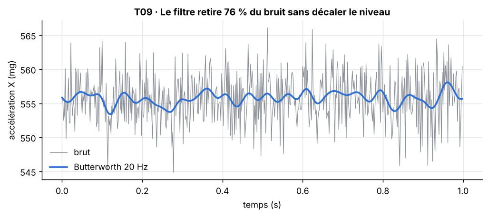

[Formation](../../../README.md) › [5 · Tests du capteur](../README.md) › TP09

# TP09 · Filtre numérique

**Statut :** à faire

| | |
|---|---|
| **Objectif** | Prouver que le filtre passe-bas retire le bruit sans fausser la mesure. |
| **Procédure** | `t09_filtre` dans [`bench/procedures.py`](../../../bench/procedures.py) |
| **Seuils** | section `T09_filtre` de [`config/limits.yaml`](../../../config/limits.yaml) |
| **Modes** | simulation (SIL) et vrai capteur (HIL) |

## 1. Pourquoi ce test

Un traitement du signal se teste comme un capteur. Un filtre qui décale la mesure introduit une erreur invisible dans tous les résultats.

## 2. Notions à connaître

- Filtre de Butterworth : réponse la plus plate possible dans la bande passante.
- Ordre du filtre : plus il est élevé, plus la coupure est raide.
- Fréquence de coupure : au-dessus, les fréquences sont atténuées.
- Pour un bruit blanc, l'écart-type est divisé environ par √(bande avant / bande après).

## 3. Conditions de mesure

Capteur immobile à 30° (niveau moyen non nul, pour mesurer un éventuel décalage). 2 000 mesures.

## 4. Méthode

1. Acquérir 2 000 mesures à 30°.
2. Appliquer un Butterworth d'ordre 4, coupure 20 Hz, en aller-retour.
3. Comparer l'écart-type avant et après, et le niveau moyen avant et après.

## 5. Le code

La procédure pilote le banc, calcule les indicateurs et compare aux seuils. Elle est identique en simulation et sur le vrai capteur.

<details>
<summary>Voir le code de <code>t09_filtre</code></summary>

```python
def t09_filtre(bench: SensorInterface, lim: dict) -> TestResult:
    c = lim["T09_filtre"]
    fs = bench.sample_rate
    _, m = _static_mean(bench, c["angle_deg"], {**lim, "acquisition": {**lim["acquisition"], "n_static": c["n"]}})
    raw = m.ax
    filtered = sp.butter_lowpass(raw, fs, c["fc_hz"])
    reduction = (1 - np.std(filtered) / np.std(raw)) * 100
    shift = abs(filtered.mean() - raw.mean()) / abs(raw.mean()) * 100
    passed = reduction >= c["min_noise_reduction_pct"] and shift <= c["max_mean_shift_pct"]
    return TestResult("T09", "Validation du filtre passe-bas", passed,
                      f"bruit réduit ≥ {c['min_noise_reduction_pct']} % et niveau décalé ≤ {c['max_mean_shift_pct']} %",
                      {"bruit brut (mg)": float(np.std(raw)) * 1000,
                       "bruit filtré (mg)": float(np.std(filtered)) * 1000,
                       "réduction du bruit (%)": float(reduction), "décalage du niveau (%)": float(shift)},
                      {"t": m.t, "raw": raw, "filtered": filtered, "fc": c["fc_hz"]}, {"statique_30deg": m})
```

</details>

## 6. Critère d'acceptation

Extrait de `config/limits.yaml` :

```yaml
T09_filtre:
  angle_deg: 30
  n: 2000
  fc_hz: 20
  min_noise_reduction_pct: 50
  max_mean_shift_pct: 1.0
```

Critère vérifié : **bruit réduit ≥ 50 % et niveau décalé ≤ 1.0 %**.

## 7. Lancer le TP

```bash
pytest tests/test_bench.py -k t09 -s                         # simulation
pytest tests/test_bench.py -k t09 -s --mode hil --port COM3  # vrai capteur (Linux : /dev/ttyUSB0)
python run_bench.py --mode hil --port COM3 --docs              # campagne complète, graphiques rangés dans les TP
```

## 8. Résultat de référence (simulation)

| Mesure | Valeur |
|---|---|
| bruit brut (mg) | 3.936 |
| bruit filtré (mg) | 0.9552 |
| réduction du bruit (%) | 75.73 |
| décalage du niveau (%) | 0.001202 |

Verdict : **OK**.



**Lire le graphique.** Gris : signal brut. Bleu : signal filtré. Le bleu doit être lisse et passer au milieu du gris.

## 9. Ce qui serait anormal

- Une courbe bleue décalée vers le haut ou le bas : le filtre modifie le niveau (erreur de conception).
- Une courbe bleue en retard sur la grise : filtre appliqué dans un seul sens.

## 10. Vos résultats sur le vrai capteur

> **À compléter** après la campagne sur le matériel. Ajoutez le graphique, remplissez le tableau et écrivez votre analyse.

**Ce à quoi s'attendre.** Si le bruit réel contient un pic (servo vers 50 Hz par exemple), le filtre à 20 Hz le supprime : la réduction du bruit peut même être meilleure qu'en simulation.

| Mesure | Simulation | Vrai capteur | Écart / commentaire |
|---|---|---|---|
| bruit brut (mg) | 3.936 | | |
| bruit filtré (mg) | 0.9552 | | |
| réduction du bruit (%) | 75.73 | | |
| décalage du niveau (%) | 0.001202 | | |

<!-- Après la campagne réelle, retirez cette ligne de commentaire et la dernière pour afficher le graphique :

-->

**Analyse :** *(Que montrent vos mesures ? Quels écarts avec la simulation, et pourquoi ? Le défaut vient-il du capteur ou du banc ?)*

## 11. Pour aller plus loin

- Essayez les coupures 5, 50 et 260 Hz dans `limits.yaml`. Pourquoi 260 Hz est-il refusé ?
- Comparez avec une moyenne glissante de même effet (`moving_average`).

## 12. Questions de révision

**Comment choisir la fréquence de coupure ?**

<details>
<summary>Réponse</summary>

Au-dessus des fréquences utiles du signal et en dessous du bruit. Trop basse, on efface le signal ; trop haute, on garde le bruit.

</details>

**Pourquoi mesurer le décalage du niveau moyen ?**

<details>
<summary>Réponse</summary>

Parce qu'un filtre doit enlever le bruit sans changer la valeur mesurée. Sinon, il introduit une erreur systématique.

</details>

## Checklist de fin de TP

- [ ] Test lancé et compris en simulation
- [ ] Test lancé sur le vrai capteur
- [ ] Graphique réel ajouté (`images/hil.png`) et affiché ci-dessus
- [ ] Tableau des résultats réels rempli
- [ ] Analyse rédigée
- [ ] Statut mis à jour ici et dans le [sommaire](../../../README.md#parcours)

---

[← TP08](../TP08-temps-de-reponse/README.md) · [Sommaire du module](../README.md) · [TP10 →](../TP10-echantillonnage/README.md)
