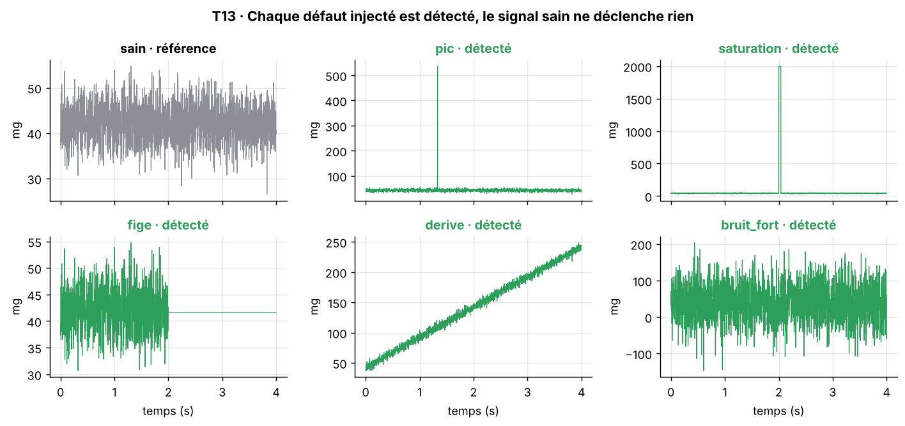

[Formation](../../../README.md) › [5 · Tests du capteur](../README.md) › TP13

# TP13 · Détection de défauts

**Statut :** à faire

| | |
|---|---|
| **Objectif** | Valider un détecteur de défauts simple et explicable sur des défauts connus. |
| **Procédure** | `t13_defauts` dans [`bench/procedures.py`](../../../bench/procedures.py) |
| **Seuils** | section `T13_defauts` de [`config/limits.yaml`](../../../config/limits.yaml) |
| **Modes** | simulation (SIL) et vrai capteur (HIL) |

## 1. Pourquoi ce test

Certains défauts passent les tests classiques : un pic isolé ne change presque pas une moyenne. Le détecteur les repère. Il sert aussi de référence pour la future partie IA (module 11).

## 2. Notions à connaître

- Injection de défauts : ajouter volontairement un défaut connu pour vérifier qu'il est détecté.
- Médiane et MAD (écart absolu médian) : statistiques robustes, peu influencées par une valeur aberrante.
- Cinq défauts types : pic isolé, saturation, capteur figé, dérive lente, bruit fort.
- Taux de détection et fausses alarmes : les deux indicateurs d'un détecteur.

## 3. Conditions de mesure

Capteur au repos, 2 000 mesures. Les défauts sont injectés par logiciel dans ce signal réel.

## 4. Méthode

1. Acquérir un signal sain et vérifier qu'aucun défaut n'est signalé.
2. Pour chaque défaut : l'injecter dans une copie du signal et lancer le détecteur.
3. Règles du détecteur : écart robuste à la médiane, échantillons à la pleine échelle, longueur des séries de valeurs identiques, pente de régression, bruit estimé par différences successives.

## 5. Le code

La procédure pilote le banc, calcule les indicateurs et compare aux seuils. Elle est identique en simulation et sur le vrai capteur.

<details>
<summary>Voir le code de <code>t13_defauts</code></summary>

```python
def t13_defauts(bench: SensorInterface, lim: dict) -> TestResult:
    c = lim["T13_defauts"]
    fs = bench.sample_rate
    bench.set_angle(0)
    bench.wait(lim["acquisition"]["settle_s"])
    m = bench.read(c["n"])
    params = dict(spike_z=c["spike_z"], stuck_run=c["stuck_run"],
                  drift_max=c["drift_max_g_per_s"], noise_max=c["noise_max_g"])
    healthy = sp.detect_faults(m.ax, fs, **params)
    false_alarms = [f for f in sp.FAULTS if healthy[f]]
    detected, signals = {}, {"sain": m.ax}
    for fault in sp.FAULTS:
        y = sp.inject_fault(m.ax, fault, fs)
        signals[fault] = y
        detected[fault] = sp.detect_faults(y, fs, **params)[fault]
    rate = sum(detected.values()) / len(detected) * 100
    passed = rate == 100 and not false_alarms
    measures = {f"défaut {f}": "détecté" if d else "MANQUÉ" for f, d in detected.items()}
    measures["taux de détection (%)"] = rate
    measures["fausses alarmes sur signal sain"] = ", ".join(false_alarms) or "aucune"
    return TestResult("T13", "Détection de défauts injectés", passed,
                      "100 % des défauts détectés, 0 fausse alarme", measures,
                      {"signals": signals, "t": m.t, "indicators": healthy["_indicateurs"]}, {"repos": m})
```

</details>

## 6. Critère d'acceptation

Extrait de `config/limits.yaml` :

```yaml
T13_defauts:
  n: 2000
  spike_z: 8.0
  stuck_run: 50
  drift_max_g_per_s: 0.01
  noise_max_g: 0.02
```

Critère vérifié : **100 % des défauts détectés, 0 fausse alarme**.

## 7. Lancer le TP

```bash
pytest tests/test_bench.py -k t13 -s                         # simulation
pytest tests/test_bench.py -k t13 -s --mode hil --port COM3  # vrai capteur (Linux : /dev/ttyUSB0)
python run_bench.py --mode hil --port COM3 --docs              # campagne complète, graphiques rangés dans les TP
```

## 8. Résultat de référence (simulation)

| Mesure | Valeur |
|---|---|
| défaut pic | détecté |
| défaut saturation | détecté |
| défaut fige | détecté |
| défaut derive | détecté |
| défaut bruit_fort | détecté |
| taux de détection (%) | 100 |
| fausses alarmes sur signal sain | aucune |

Verdict : **OK**.



**Lire le graphique.** Six signaux : le gris est la référence saine, chaque vert est un défaut injecté et détecté (rouge s'il était manqué).

## 9. Ce qui serait anormal

- Une fausse alarme sur le signal sain : seuil trop sévère.
- Un défaut manqué : seuil trop large, ou règle inadaptée.

## 10. Vos résultats sur le vrai capteur

> **À compléter** après la campagne sur le matériel. Ajoutez le graphique, remplissez le tableau et écrivez votre analyse.

**Ce à quoi s'attendre.** Les défauts sont injectés dans votre vrai signal de repos : le test vérifie que le détecteur ne déclenche pas de fausse alarme sur votre bruit réel. Si c'est le cas, ajustez les seuils dans `limits.yaml` et justifiez-le.

| Mesure | Simulation | Vrai capteur | Écart / commentaire |
|---|---|---|---|
| défaut pic | détecté | | |
| défaut saturation | détecté | | |
| défaut fige | détecté | | |
| défaut derive | détecté | | |
| défaut bruit_fort | détecté | | |
| taux de détection (%) | 100 | | |
| fausses alarmes sur signal sain | aucune | | |

<!-- Après la campagne réelle, retirez cette ligne de commentaire et la dernière pour afficher le graphique :

-->

**Analyse :** *(Que montrent vos mesures ? Quels écarts avec la simulation, et pourquoi ? Le défaut vient-il du capteur ou du banc ?)*

## 11. Pour aller plus loin

- Provoquez de vrais défauts : tapotez le capteur (pic), faites un faux contact sur SDA (erreur ou valeur figée).
- Réduisez l'amplitude du pic injecté jusqu'à ce qu'il ne soit plus détecté : c'est la sensibilité du détecteur.

## 12. Questions de révision

**Pourquoi la médiane et le MAD plutôt que la moyenne et l'écart-type ?**

<details>
<summary>Réponse</summary>

Parce qu'ils ne sont presque pas influencés par le pic qu'on cherche. La moyenne et l'écart-type seraient tirés par lui et le masqueraient en partie.

</details>

**Pourquoi injecter des défauts dans un vrai signal ?**

<details>
<summary>Réponse</summary>

Pour tester le détecteur avec le vrai bruit du capteur, et vérifier qu'il ne déclenche pas de fausse alarme dans les conditions réelles.

</details>

## Checklist de fin de TP

- [ ] Test lancé et compris en simulation
- [ ] Test lancé sur le vrai capteur
- [ ] Graphique réel ajouté (`images/hil.png`) et affiché ci-dessus
- [ ] Tableau des résultats réels rempli
- [ ] Analyse rédigée
- [ ] Statut mis à jour ici et dans le [sommaire](../../../README.md#parcours)

---

[← TP12](../TP12-robustesse/README.md) · [Sommaire du module](../README.md) · [Module 6 · Automatisation →](../../06-automatisation/README.md)
